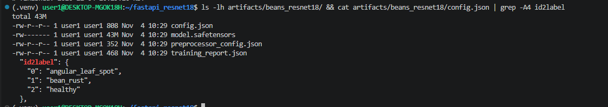
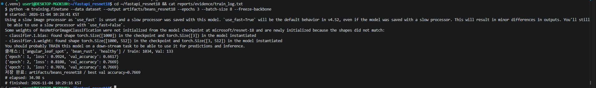
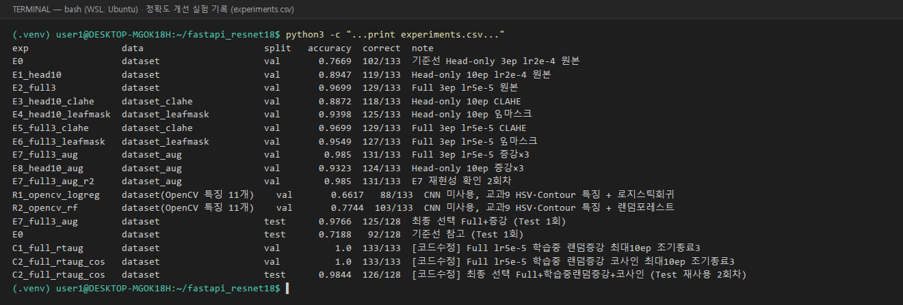
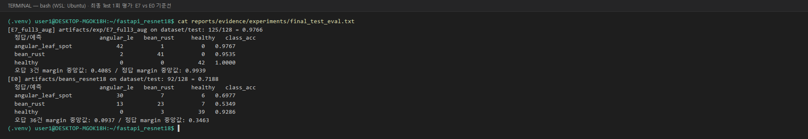
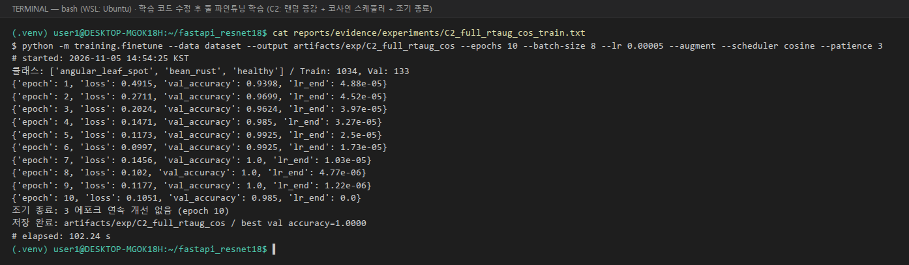
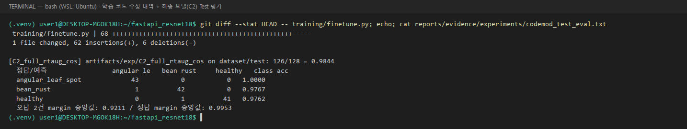

# 산출물 1. ResNet18 콩잎 3클래스 Fine-tuning 결과보고서

- 평가 대상: 콩잎 이미지 3클래스 분류 (`angular_leaf_spot` / `bean_rust` / `healthy`)
- 기준 모델: `microsoft/resnet-18` (ImageNet 1,000클래스 사전학습, Apache-2.0)
- 학습 방식: **Head-only Fine-tuning** (`--freeze-backbone`, Backbone 고정 · 분류 헤드만 학습)
- 입력 데이터: `dataset/train`, `dataset/val`
- 보관 데이터: `dataset/test` (학습·모델 선택에 사용하지 않음)
- 모델 저장 위치: `artifacts/beans_resnet18/`
- 실험 상태: **실행 완료** (2026-11-04 10:28:41 ~ 10:29:16 KST, 34.98초)
- 정확도 개선 최종 모델: **C2** — 학습 코드 수정(학습 중 랜덤 증강·코사인 학습률 스케줄러·조기 종료) 후 Full Fine-tuning, Validation 1.0000 / Test **0.9844** (7-9절)

---

## 1. 데이터 구성

### 1-1. 출처와 원본 보존

| 항목 | 내용 |
|---|---|
| 데이터셋 | Hugging Face [`AI-Lab-Makerere/beans`](https://huggingface.co/datasets/AI-Lab-Makerere/beans) (라이선스 MIT) |
| 다운로드 파일 | `data/train.zip`(138MB), `data/validation.zip`(18MB), `data/test.zip`(17MB) |
| 원본 보존 위치 | `~/beans_source/zips/*.zip`, 압축 해제본 `~/beans_source/{train,validation,test}/` |
| 실행용 위치 | `~/fastapi_resnet18/dataset/{train,val,test}/` (원본에서 **복사**) |
| 정답 라벨 | 제공 데이터의 **폴더명**을 그대로 사용 (사진을 보고 임의로 정하지 않음) |

### 1-2. 원본 → 코드 실행용 폴더 매핑

| 원본 폴더 (`beans_source/`) | 코드 실행 폴더 (`dataset/`) | 용도 |
|---|---|---|
| `train/` | `train/` | 가중치 학습 |
| `validation/` | **`val/`** | 학습 중 성능 확인·최고 모델 선택 (제공 코드가 `dataset/val`을 읽음) |
| `test/` | `test/` | 학습에 미사용 |

### 1-3. 클래스별 실제 이미지 수

| 클래스 | Train | Validation (`val`) | Test |
|---|---:|---:|---:|
| angular_leaf_spot | 345 | 44 | 43 |
| bean_rust | 348 | 45 | 43 |
| healthy | 341 | 44 | 42 |
| **합계** | **1,034** | **133** | **128** |

- 원본(`beans_source`)과 실행용(`dataset`)의 클래스별 개수가 모두 일치함을 확인했다.
- 학습 코드 출력 `클래스: ['angular_leaf_spot', 'bean_rust', 'healthy'] / Train: 1034, Val: 133`과도 일치한다.

### 1-4. 데이터 정제·누출 점검

| 점검 | 방법 | 결과 |
|---|---|---|
| 비이미지 파일 | ZIP 내부 확장자 확인 | `train.zip`의 `train/healthy/healthy_train.120tore` 1개는 macOS 메타데이터 파일(헤더 `Bud1`, `.DS_Store` 형식)이므로 **제외**. 제공 학습 코드도 `.jpg/.jpeg/.png/.webp`만 읽으므로 학습 입력은 동일 |
| 완전 중복 | 전체 1,295장의 SHA-256 해시 비교 | 중복 그룹 **0건** |
| Split 간 누출 | 같은 해시가 train/val/test에 동시에 있는지 확인 | **0건** |
| 한계 | 해시 비교는 바이트 단위 동일 파일만 검출 | 같은 잎을 다르게 찍은 **유사 이미지는 미점검** |

---

## 2. 실행 설정

### 2-1. 실행 명령 (제공 코드 · 옵션 그대로)

```bash
python -m training.finetune --data dataset --output artifacts/beans_resnet18 --epochs 3 --batch-size 8 --freeze-backbone
```

| 파라미터 | 값 | 근거 |
|---|---|---|
| base_model | `microsoft/resnet-18` | `training/finetune.py`의 `BASE_MODEL` |
| epochs | 3 | 실행 옵션 |
| batch_size | 8 | 실행 옵션 |
| learning_rate | 0.0002 | 제공 코드 기본값 `--lr 2e-4` |
| optimizer | AdamW (`requires_grad=True` 파라미터만) | 제공 코드 |
| freeze_backbone | **True** | 실행 옵션 |
| seed | 42 (`random`, `torch`) | 제공 코드 |
| 전처리 | 짧은 변 224 리사이즈, crop_pct 0.875, ImageNet 평균·표준편차 정규화 | `preprocessor_config.json` |
| 학습 장치 | NVIDIA GeForce RTX 3060 (CUDA, 코드가 자동 선택) | `torch.cuda.is_available()=True` |
| 출력 | `artifacts/beans_resnet18` | 평가 지정 경로 |

### 2-2. 출력층 교체와 Head-only 확인

학습 로그에 다음 경고가 출력되었다. 이는 오류가 아니라 **1,000클래스 출력층이 3클래스 출력층으로 교체되었다는 증거**다.

```text
- classifier.1.bias: found shape torch.Size([1000]) in the checkpoint and torch.Size([3]) in the model instantiated
- classifier.1.weight: found shape torch.Size([1000, 512]) in the checkpoint and torch.Size([3, 512]) in the model instantiated
```

| 항목 | 값 |
|---|---:|
| 전체 파라미터 | 11,178,051 |
| 학습 대상 (`classifier.`로 시작) | **1,539** (= 512×3 가중치 + 3 bias) |
| 학습 비율 | **0.0138%** |

- 코드: `parameter.requires_grad = name.startswith("classifier.")` → Backbone(합성곱 층)은 고정되고 새 분류 헤드만 학습된다.
- 따라서 본 실험은 **Head-only Fine-tuning**이며 전체 모델 학습(Full Fine-tuning)이 아니다.

---

## 3. 학습 결과

| Epoch | Train Loss | Validation Accuracy | 모델 저장 |
|---:|---:|---:|---|
| 1 | 0.9924 | 0.6617 | 저장 (첫 최고값) |
| 2 | 0.8108 | **0.7669** | **저장 (최고값 갱신)** |
| 3 | 0.7078 | 0.7669 | 미저장 (`acc > best_acc` 조건 불충족, 동점) |

- **Best Validation Accuracy: 0.7669** (133장 중 102장 정답)
- 최종 저장 모델: **Epoch 2 시점의 가중치** (`artifacts/beans_resnet18/`)
- Train Loss가 3 epoch 동안 계속 감소 중(0.99 → 0.71)이므로 학습량이 부족한 상태(과소적합 가능성)로 해석한다.
- **Test Accuracy:** 제공 코드에는 Test 평가 절차가 없다. 추가 평가 스크립트로 최종 모델 확정 후 1회 측정한 값은 **0.7188 (92/128)** (7-7절)
- 클래스별 정확도·혼동행렬: 7-4절(val), 7-7절(Test). Precision·Recall·F1: **미측정**

### `training_report.json` 원본 (`artifacts/beans_resnet18/training_report.json`)

```json
{
  "base_model": "microsoft/resnet-18",
  "classes": ["angular_leaf_spot", "bean_rust", "healthy"],
  "train_count": 1034,
  "val_count": 133,
  "best_val_accuracy": 0.7669172932330827,
  "history": [
    {"epoch": 1, "loss": 0.9924, "val_accuracy": 0.6617},
    {"epoch": 2, "loss": 0.8108, "val_accuracy": 0.7669},
    {"epoch": 3, "loss": 0.7078, "val_accuracy": 0.7669}
  ]
}
```

보고서의 수치는 위 JSON 및 학습 로그(`evidence/train_log.txt`)와 일치한다.

---

## 4. 생성 파일 확인

| 파일 | 크기 | 역할 |
|---|---:|---|
| [x] `config.json` | 808 B | 모델 구조, `id2label` = {0: angular_leaf_spot, 1: bean_rust, 2: healthy} |
| [x] `model.safetensors` | 43 MB | 학습된 가중치 |
| [x] `preprocessor_config.json` | 352 B | 입력 전처리 규칙 |
| [x] `training_report.json` | 468 B | 학습 기록 |



---

## 5. 서비스 연결 확인

- `.env`: `MODEL_PATH=artifacts/beans_resnet18`
- FastAPI·Celery Worker 응답의 `model_id`가 모두 `artifacts/beans_resnet18`임을 확인 (API 응답 및 `image_jobs` 16행 전체)
- 동기 API 시연 결과 (정답은 Test 폴더 라벨, **시연용 개별 사례이며 Test 정확도가 아님**)

| 이미지 | 폴더 라벨 | 예측 | score | 일치 | 증빙 |
|---|---|---|---:|---|---|
| `test/bean_rust/bean_rust_test.26.jpg` | bean_rust | bean_rust | 0.4638 | O | `evidence/ui_sync_correct.png` |
| `test/bean_rust/bean_rust_test.10.jpg` | bean_rust | angular_leaf_spot | 0.3825 | X | `evidence/ui_sync.png` |
| `test/healthy/healthy_test.26.jpg` | healthy | healthy | 0.8984 | O | `evidence/functional_tests.txt` (T-02) |

---

## 6. 결과 판정

- **완료:** Head-only Fine-tuning 학습, 모델 파일 4종 생성, 서비스(동기·비동기) 연결
- **성능:** Best Validation Accuracy 0.7669
- **관찰된 한계:**
  - 3 epoch에서 Loss가 계속 감소 중 → 학습량 부족 가능성
  - 시연에서 `bean_rust`를 `angular_leaf_spot`으로 혼동하는 사례 관찰 (두 질병 모두 잎의 반점이 특징)
  - 오분류 사례의 점수가 0.38 / 0.32 / 0.29로 세 클래스가 비슷 → 확신이 낮은 예측
  - Test 정확도 0.7188 (클래스별 bean_rust 0.5349로 가장 낮음)
- **선택 실험 (정확도 개선):** **실행 완료** — 아래 7장. 서비스 모델(`MODEL_PATH`)은 평가 지정대로 이 Head-only 모델을 유지
- **증빙:** [`evidence/train_log.png`](evidence/train_log.png), [`evidence/train_log.txt`](evidence/train_log.txt), [`evidence/model_folder.png`](evidence/model_folder.png)



---

## 7. 선택 실험: 정확도 개선 (교과 9 기법 적용)

### 7-1. 실험 규칙

| 규칙 | 적용 |
|---|---|
| 제공 코드 | E0~E8은 `training/finetune.py` **수정 없이** `--data`(전처리한 데이터 폴더)와 실행 옵션만 변경. 이후 **학습 코드를 수정**해 옵션 3개를 추가하고 C1·C2를 실험했다(7-9절). 추가 옵션의 기본값은 '사용 안 함'이라 E0~E8 명령은 수정 후에도 같은 방식으로 동작한다 |
| 저장 위치 | `artifacts/exp/<실험명>/` — 기준선 `artifacts/beans_resnet18`과 서비스는 변경 없음 |
| 비교 조건 | 모든 실험을 **같은 Validation 133장**으로 비교 (전처리 실험은 같은 133장에 같은 전처리 적용) |
| 모델 선택 | **Validation으로만** 선택. Test 128장은 최종 모델 확정 후 **1회만** 평가 (코드 수정 후 C2 평가는 **Test 재사용 2회차**로 따로 표시, 7-9절) |
| 추가 코드 | `experiments/` (전처리·증강·평가·특징 분류·규칙 분석) — 제공 코드와 분리, 실험 전용 패키지는 `experiments/requirements-exp.txt` |
| 실험 기록 (교과 9 · 실험관리) | 실험 1건 = `reports/data/experiments.csv` 1줄, 이미지별 예측 `reports/data/preds/`, 로그 `reports/evidence/experiments/` |
| 실행 | `bash experiments/run_all.sh` → `run_followup.sh` → `run_final_test.sh` → (코드 수정 후) `run_codemod.sh` → `run_codemod_test.sh` |

### 7-2. 실험 구성

| 실험 | 데이터 (교과 9) | 학습 방식 | 핵심 옵션 |
|---|---|---|---|
| E0 | 원본 | Head-only | 3 epoch, lr 2e-4 (기준선) |
| E1 | 원본 | Head-only | **10 epoch** |
| E3 | **CLAHE** — LAB의 L 채널 대비 보정 (Image Enhancement) | Head-only | 10 epoch |
| E4 | **잎 마스크** — HSV inRange → Opening/Closing → Contour 채우기 → 배경 제거 (HSV, Morphology·Contour) | Head-only | 10 epoch |
| E8 | **데이터 증강 ×3** — 반전·90° 회전·밝기/대비 ±20%, train에만 (데이터 생성) | Head-only | 10 epoch |
| E2 | 원본 | **Full Fine-tuning** (`--freeze-backbone` 없음) | 3 epoch, **lr 5e-5** |
| E5 | CLAHE | Full | 3 epoch, lr 5e-5 |
| E6 | 잎 마스크 | Full | 3 epoch, lr 5e-5 |
| E7 | 데이터 증강 ×3 | Full | 3 epoch, lr 5e-5 |
| R1 / R2 | 원본에서 **OpenCV 특징 11개** 추출 (잎 면적비, 갈색·황색 비율, 반점 개수·크기, 잎 HSV 평균·표준편차) — CNN 미사용 | 로지스틱회귀 / 랜덤포레스트 | train으로 학습 |

### 7-3. 잎 마스크 조정 과정 (v1 → v2)

| 버전 | 설정 | 관찰 (val 예시 9장) | 판단 |
|---|---|---|---|
| v1 | H 22~95, 사각 5×5 Opening ×2, **사각 25×25 Closing ×2** | 경계가 블록 모양, 잎 사이 **흙까지 메워짐**, 그늘진 청록색 잎 일부 **누락** | 사용 안 함 |
| v2 | H 22~**100**, 타원 3×3 Opening, **타원 9×9 Closing ×2**, 면적 1.5% 이상 외곽 Contour **채우기**(병반 구멍 메움) | 경계 자연스러움, 흙 대부분 제거, 그늘진 잎 포함 | **채택** |

- 그림: [`figures/preprocess_examples.png`](figures/preprocess_examples.png) (v1), [`figures/preprocess_examples_v2.png`](figures/preprocess_examples_v2.png) (v2) — 열: 원본 · CLAHE · 마스크 · 마스크 적용
- v2 마스크 면적비 중앙값: train 0.674 / val 0.669 / test 0.691. 마스크 실패(면적 15% 미만 → 원본 유지): train 5장, val·test 0장
- **한계:** 같은 녹색인 잡초·주변 잎은 색만으로 분리되지 않아 남는다. 잎 가장자리 병반이 마스크 경계에서 잘릴 수 있다.

### 7-4. Validation 결과 (133장)

| 실험 | 정확도 | 정답 수 | angular_leaf_spot | bean_rust | healthy | 학습 시간 |
|---|---:|---:|---:|---:|---:|---:|
| R1 OpenCV 특징 + 로지스틱회귀 | 0.6617 | 88 | 0.5000 | 0.6222 | 0.8636 | — |
| **E0 기준선** (Head 3ep) | **0.7669** | 102 | 0.7500 | 0.6444 | 0.9091 | 35.0 s |
| R2 OpenCV 특징 + 랜덤포레스트 | 0.7744 | 103 | 0.6591 | 0.8000 | 0.8636 | — |
| E3 Head 10ep + CLAHE | 0.8872 | 118 | 0.9318 | 0.8444 | 0.8864 | 143.0 s |
| E1 Head 10ep | 0.8947 | 119 | 0.8864 | 0.8667 | 0.9318 | 83.9 s |
| E8 Head 10ep + 증강 | 0.9323 | 124 | 0.8636 | 1.0000 | 0.9318 | 222.0 s |
| E4 Head 10ep + 잎 마스크 | 0.9398 | 125 | 0.9545 | 0.9111 | 0.9545 | 114.5 s |
| E6 Full + 잎 마스크 | 0.9549 | 127 | 0.9545 | 0.9556 | 0.9545 | 40.2 s |
| E2 Full | 0.9699 | 129 | 0.9545 | 0.9778 | 0.9773 | 30.7 s |
| E5 Full + CLAHE | 0.9699 | 129 | 0.9773 | 1.0000 | 0.9318 | 46.5 s |
| **E7 Full + 증강** | **0.9850** | **131** | 0.9773 | 0.9778 | **1.0000** | 73.1 s |
| E7 재현 (2회차) | 0.9850 | 131 | 0.9773 | 0.9778 | 1.0000 | 73.7 s |
| C1 [코드 수정] Full + 학습 중 랜덤 증강 (최대 10ep) | 1.0000 | 133 | 1.0000 | 1.0000 | 1.0000 | 108.7 s |
| **C2 [코드 수정] C1 + 코사인 스케줄러** | **1.0000** | **133** | 1.0000 | 1.0000 | 1.0000 | 102.2 s |



### 7-5. 요인별 효과 (같은 학습 방식 안에서 비교)

| 요인 | Head-only 10ep 기준 (E1 0.8947) | Full 기준 (E2 0.9699) |
|---|---|---|
| 학습량 3 → 10 epoch | E0 → E1: **+12.8%p** (+17장) | — |
| Head-only → Full | E1 → E2: **+7.5%p** (+10장) | — |
| CLAHE | E3: −0.8%p (−1장) → **효과 없음** | E5: ±0 → **효과 없음** |
| 잎 마스크 | E4: **+4.5%p** (+6장) → **효과 있음** | E6: −1.5%p (−2장) → 효과 없음·소폭 하락 |
| 데이터 증강 | E8: **+3.8%p** (+5장), bean_rust 1.0 | E7: **+1.5%p** (+2장) → **최고** |

- **반복 실행 편차:** seed 42로 고정해도 GPU 연산 비결정성 때문에 결과가 조금 달라질 수 있다. E2 설정은 다른 회차 실행에서 0.9774(130장)였다. 따라서 **1~2장(0.75~1.5%p) 차이는 우연일 수 있다.** E7은 2회 모두 0.9850, 혼동행렬도 같았다.

**해석**
1. **가장 큰 개선은 학습량과 Full Fine-tuning에서 나왔다.** Backbone까지 학습하면 ImageNet 특징이 콩잎 병반(녹병의 주황 점, 반점병의 각진 갈색 반점)을 구분하도록 조정된다.
2. **잎 마스크는 Backbone을 고정한 Head-only에서만 효과가 컸다(+6장).** 고정된 Backbone은 흙 배경을 스스로 무시하지 못하므로 배경 제거가 도움이 됐다. Full에서는 모델이 배경을 무시하도록 스스로 학습할 수 있어, 마스크로 생기는 정보 손실(가장자리 병반, 잎 사이 맥락)이 더 크게 작용한 것으로 추정한다(검증하지 않은 가설).
3. **CLAHE는 효과가 없었다.** 이 데이터는 대부분 야외 낮 촬영이라 대비 부족이 주요 오류 원인이 아니었던 것으로 보인다.
4. **데이터 증강은 두 방식 모두에서 개선됐다.** 회전·반전·밝기 변화에도 병명이 바뀌지 않는다는 점을 학습해 일반화가 좋아졌다.
5. **OpenCV 특징만으로도(R2) 기준선 CNN과 비슷한 0.77**이 나왔다. 중요도가 높은 특징은 잎 면적비, 잎 색상 평균(H), 황색 비율 순이었다. train 평균에서 angular_leaf_spot은 황색 비율 0.172, 반점 수 93개로 healthy(0.048, 54개)보다 높았다. 규칙 기반 특징에 질병 정보가 담겨 있음을 확인했지만, 학습한 CNN보다는 낮다.

### 7-6. CNN + 규칙 보류 (복합 Rule) — val

규칙: 1·2위 확률 차(margin)가 임계값 미만이면 자동 판정하지 않고 "확인 필요"로 보류한다(라벨은 바꾸지 않음).

| 모델 | margin < | 보류율 | 자동 판정 정확도 | 자동 판정 오답 |
|---|---:|---:|---:|---:|
| E0 | 0 (규칙 없음) | 0% | 0.7669 | 31 |
| E0 | 0.2 | 39.1% (52장) | 0.8642 | 11 |
| E0 | 0.3 | 58.6% (78장) | 0.9091 | 5 |
| E4 | 0.2 | 18.0% (24장) | 0.9633 | 4 |
| E4 | 0.3 | 22.6% (30장) | 0.9806 | 2 |
| E7 | 0.1 ~ 0.3 | 0.8~1.5% (1~2장) | 0.9847 | 2 |

- 약한 모델(E0)에서는 규칙으로 오답을 크게 줄일 수 있지만, **보류율이 너무 높아** 자동화 효과가 작다.
- 코드 수정 전 최종 모델(E7)은 남은 오답 2장이 margin 0.56·0.77로 **확신 있게 틀린 경우**라 이 규칙으로 걸러지지 않는다.
- 임계값 후보는 미리 정한 값(0.1·0.2·0.3)만 비교했다. 운영 기준을 정하려면 별도 데이터로 다시 확인해야 한다.

### 7-7. 최종 모델 선택과 Test 평가 (1회) — 코드 수정 전

> 이 절은 학습 코드를 수정하기 전의 최종 결과다. 코드 수정 후 최종 모델(C2)은 7-9절.

- **선택:** E7 (Full Fine-tuning + 데이터 증강) — val 최고 0.9850, 2회 실행 재현
- **장점:** 추론 시 **원본 이미지를 그대로 입력**한다(증강은 학습 데이터에만 적용). 따라서 서비스 코드 변경 없이 `MODEL_PATH`만 바꾸면 적용할 수 있다. 잎 마스크 모델(E4)은 서비스에도 같은 전처리 코드를 추가해야 한다.

| 모델 | Test 정확도 | 정답 수 | angular_leaf_spot | bean_rust | healthy |
|---|---:|---:|---:|---:|---:|
| E0 기준선 (참고) | 0.7188 | 92 / 128 | 0.6977 | 0.5349 | 0.9286 |
| **E7 최종** | **0.9766** | **125 / 128** | 0.9767 | 0.9535 | 1.0000 |



- **Test 기준 +25.8%p** (92 → 125장). Test는 이 두 모델에만 1회 사용했으며, 모델·설정 선택에는 쓰지 않았다.
- E7 Test 오답 3장: `angular_leaf_spot_test.14`→bean_rust, `bean_rust_test.15`→angular, `bean_rust_test.31`→angular. **남은 오류도 녹병 ↔ 반점병 혼동**이다.
- 시연에서 기준선이 틀린 사진은 E7에서 모두 맞았다.

| 이미지 | E0 예측 | E7 예측 |
|---|---|---|
| `bean_rust_test.10.jpg` | angular_leaf_spot 0.38 ❌ | **bean_rust 0.95** ✅ |
| `bean_rust_test.30.jpg` | angular_leaf_spot 0.44 ❌ | **bean_rust 0.98** ✅ |
| `healthy_test.40.jpg` | bean_rust 0.42 ❌ | **healthy 0.97** ✅ |

### 7-8. 서비스 반영 여부

- **현재 서비스는 평가 지정 모델(E0, `artifacts/beans_resnet18`)을 유지**한다. 산출물 2~7의 측정·캡처는 모두 E0 기준이다.
- 개선 모델(C2 또는 E7)을 서비스에 쓰려면 `.env`를 `MODEL_PATH=artifacts/exp/C2_full_rtaug_cos`로 바꾸고 FastAPI·Worker를 재시작한 뒤, 성능 측정(산출물 6)과 캡처를 다시 해야 한다. **미실시.**

### 7-9. 학습 코드 수정 후 Full Fine-tuning 재실험 (최종)

E7까지는 제공 학습 코드의 옵션만 바꿨다. 옵션으로는 할 수 없는 개선을 위해 **`training/finetune.py`를 수정**했다 (+62줄 / −6줄, `[수정]` 주석으로 표시).

| 수정 내용 | 새 옵션 | 동작 | E7 방식과 차이 |
|---|---|---|---|
| 학습 중 랜덤 증강 | `--augment` | train 이미지를 불러올 때마다 좌우·상하 반전, 90° 회전, 밝기·대비 ±20%를 랜덤 적용 (색상 Hue는 변경 안 함, val·test는 원본) | E7은 미리 만든 증강 사진 2장(고정)을 씀 → 수정 후에는 **에포크마다 다른 변형**을 봄 |
| 코사인 학습률 스케줄러 | `--scheduler cosine` | 학습률을 배치마다 5e-5 → 0으로 코사인 곡선을 따라 줄임 | E7은 학습률 고정 |
| 조기 종료 | `--patience N` | 검증 정확도가 N 에포크 연속 오르지 않으면 학습 중단 (저장 모델은 최고 시점) | E7은 정해진 3 에포크 |
| 학습 설정 기록 | — | `training_report.json`에 `options`, `stopped_epoch` 저장 | 재현용 |

- 세 옵션의 기본값은 모두 '사용 안 함'이라, 옵션을 주지 않으면 수정 전과 같은 방식으로 학습한다.

**실험 설정** (공통: 원본 `dataset`, Full Fine-tuning, lr 5e-5, batch 8, seed 42, 최대 10 에포크, `--patience 3`)

| 실험 | 추가 옵션 | 에포크별 Validation | 최고 (저장 시점) |
|---|---|---|---:|
| C1 | `--augment` | 0.940 → 0.970 → 0.962 → 0.977 → 0.985 → 0.992 → 0.992 → 0.992 → **1.000** → 0.992 | 1.0000 (9) |
| C2 | `--augment --scheduler cosine` | 0.940 → 0.970 → 0.962 → 0.985 → 0.992 → 0.992 → **1.000 → 1.000 → 1.000** → 0.985 | 1.0000 (7) |



- 고정 증강(E7)에서는 3 에포크 이후 개선 여지가 작았지만, **랜덤 증강은 매 에포크 새로운 변형을 보여 줘서 10 에포크까지 학습해도 과적합 없이 올라갔다.**
- C2의 조기 종료는 마지막 10 에포크에서 걸려 실제로 학습 시간을 줄이지는 못했다. 저장 모델은 최고 시점(7 에포크)이다.
- **최종 선택: C2** — C1·C2 모두 Validation 1.0000이지만, C2는 1.0을 **3 에포크 연속 유지**해 더 안정적이고(C1은 1회), 수정한 기능 3가지를 모두 사용한다. **Test를 보기 전에 Validation만으로 결정했고, C1은 Test에 넣지 않았다.**
- Validation 1.0000은 133장에서 고른 최고값이라 실제보다 낙관적일 수 있다. 일반화 성능은 Test로 확인한다.

**Test 평가 (재사용 2회차)**

| 모델 | Test 정확도 | 정답 수 | angular_leaf_spot | bean_rust | healthy |
|---|---:|---:|---:|---:|---:|
| E0 기준선 (참고) | 0.7188 | 92 / 128 | 0.6977 | 0.5349 | 0.9286 |
| E7 (코드 수정 전 최종) | 0.9766 | 125 / 128 | 0.9767 | 0.9535 | 1.0000 |
| **C2 (코드 수정 후 최종)** | **0.9844** | **126 / 128** | **1.0000** | 0.9767 | 0.9762 |



- **Test 기준 E7 대비 +0.8%p (+1장), E0 대비 +26.6%p (+34장).**
- C2 오답 2장: `bean_rust_test.15` → angular_leaf_spot (margin 0.92, E7도 틀린 사진), `healthy_test.35` → bean_rust (margin 0.12, 확신 낮음). E7의 오답 `angular_leaf_spot_test.14`, `bean_rust_test.31`은 C2에서 맞았다.
- 시연 사진 `bean_rust_test.10`(bean_rust 0.99), `bean_rust_test.30`(0.96), `healthy_test.40`(healthy 0.91) 모두 정답.
- **주의:** Test는 E7 평가에 이미 1회 사용했으므로 C2 평가는 **재사용(2회차)**이다. 모델 선택에는 Test를 쓰지 않았지만, 128장에서 1장 차이(0.8%p)는 우연일 수 있다. 따라서 "C2가 E7보다 확실히 낫다"가 아니라 **"코드 수정 후에도 같은 수준 이상(98.4%)을 유지했다"**로 판단한다.

**증빙:** [`data/experiments.csv`](data/experiments.csv), [`data/preds/`](data/preds/), [`evidence/experiments/`](evidence/experiments/) (실험별 학습 로그·평가·`final_test_eval.txt`·`review_rule_val.txt`·`R_opencv_features.txt`)
