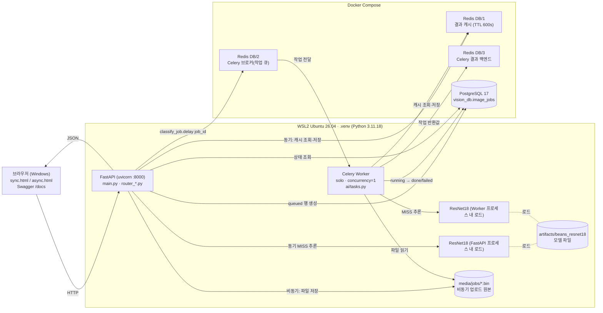
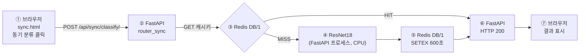
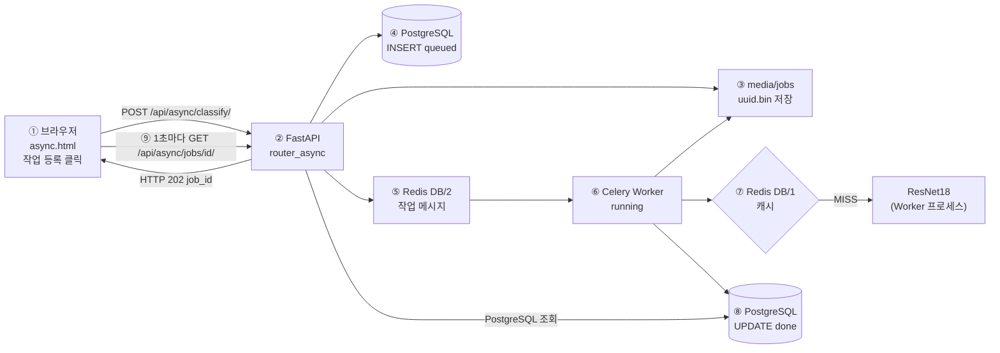
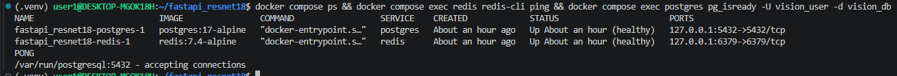

# 산출물 2. 전체 시스템 아키텍처

## 1. 구성도

## 1-1. AI 추론 버튼을 눌렀을 때 거치는 구성요소

### "동기 분류" 버튼

| 순서 | 구성요소 | 실행 위치 | 하는 일 | 실측 근거 |
|---:|---|---|---|---|
| ① | 브라우저 | Windows | 선택 파일을 `FormData`로 전송, 응답 대기 | `ui_sync.png` |
| ② | FastAPI | WSL `.venv` | 크기·형식 검증 (413/400) | — |
| ③ | Redis Cache DB/1 | Docker | 같은 모델·같은 이미지 결과가 있는지 조회 | HIT 1.5ms (`timings.csv`) |
| ④ | ResNet18 | FastAPI 프로세스 | MISS일 때만 추론 | `inference_ms` 14.78ms (중앙값) |
| ⑤ | Redis Cache DB/1 | Docker | 결과 600초 저장 | 이후 같은 이미지 HIT |
| ⑥⑦ | FastAPI → 브라우저 | — | 200 + JSON | MISS 전체 20.0ms |

### "Celery 작업 등록" 버튼

| 순서 | 구성요소 | 실행 위치 | 하는 일 | 실측 근거 (job 14) |
|---:|---|---|---|---|
| ① | 브라우저 | Windows | 파일 전송 | `ui_async.png` |
| ②~⑤ | FastAPI → 파일·PostgreSQL·Redis DB/2 | WSL / Docker | 검증 → 원본 저장 → `queued` 행 → 큐 등록 → **202 즉시 응답** | 접수 35ms |
| ⑥ | Celery Worker | WSL 별도 프로세스 | 큐에서 job_id 수신, `running` 기록 | `11:59:33,929 received` (`celery_log.png`) |
| ⑦ | Redis DB/1 + ResNet18 | Docker / Worker 프로세스 | 캐시 확인, MISS면 추론 | `inference_ms` 57.71 |
| ⑧ | PostgreSQL | Docker | `done` + 결과 저장 | `11:59:34,013 succeeded in 0.083s`, `db_rows.png` id 14 |
| ⑨ | 브라우저 → FastAPI → PostgreSQL | — | 상태 폴링, `done`이면 결과 표시 | 전체 1,064ms (1초 폴링 포함) |

### 장애가 났을 때 구성요소별 동작 (실측, `evidence/redis_outage_test.txt`)

| 멈춘 구성요소 | 동기 버튼 | 비동기 버튼 |
|---|---|---|
| Redis (캐시+브로커) | **200 정상** — 캐시를 건너뛰고 추론 (로그 `Redis 조회 불가; 모델 추론으로 전환`) | **503** — 큐 등록 실패, DB 행은 `failed`로 기록 (job 15) |
| Celery Worker | 영향 없음 | **202 후 `queued` 유지** → Worker 재시작 시 처리 (job 12) |
| Redis 복구 후 | 정상 | Worker 자동 재연결 (약 2초), 이후 작업 `done` (job 16) |

## 2. 컴포넌트 역할

| 컴포넌트 | 실행 위치 | 사용 파일 / 서비스 | 역할 |
|---|---|---|---|
| 브라우저 | Windows 웹브라우저 | `templates/sync.html`, `templates/async.html`, `static/style.css` | 이미지 업로드, 결과·상태 표시 |
| FastAPI | WSL2 `.venv`, `uvicorn main:app --host 127.0.0.1 --port 8000` | `main.py`, `ai/router_sync.py`, `ai/router_async.py`, `ai/router_web.py` | HTTP 요청 검증·응답, 작업 접수, 상태 조회 |
| ResNet18 | FastAPI·Worker **각 프로세스에 별도 로드** | `ai/hf_model.py`(`lru_cache`), `ai/services.py`, `artifacts/beans_resnet18/` | 이미지 3클래스 분류 (CPU, `device=-1`) |
| Redis Cache | Docker `redis:7.4-alpine` DB/1 | `ai/cache_service.py` | 같은 이미지·같은 모델 결과 재사용 (키: 모델경로 해시 + 이미지 SHA-256) |
| Redis Broker | Docker Redis DB/2 | `ai/celery_app.py` | Celery 작업 메시지 전달 |
| Redis Result | Docker Redis DB/3 | `ai/celery_app.py` | Celery 작업 반환값 저장 (API는 사용하지 않고 DB를 조회) |
| PostgreSQL | Docker `postgres:17-alpine` | `ai/database.py`, `ai/models.py` | `image_jobs`에 비동기 작업 상태·결과 기록 |
| Celery Worker | WSL2 `.venv`, 별도 프로세스 | `ai/tasks.py` | 비동기 추론, DB 상태 갱신 |
| 업로드 원본 | WSL2 파일시스템 | `media/jobs/<uuid>.bin` | 비동기 이미지 원본 (DB에는 파일명만 저장) |

**설계상 확인 사항**
- **Docker 안에는 Redis·PostgreSQL만 있다.** FastAPI와 Celery는 WSL 가상환경에서 실행한다(`evidence/docker_ps.png`에 `web`/`worker` 컨테이너 없음).
- **Redis는 캐시(DB/1)와 브로커(DB/2)의 역할이 분리**되어 있다.
- **모델은 FastAPI와 Worker 두 프로세스에 각각 로드된다.** 실제로 각 프로세스의 첫 추론에서 모델 로딩 시간이 관찰되었다: FastAPI 첫 요청 `inference_ms=5510.95`, Worker 첫 작업 `inference_ms=5596.06` (`reports/data/timings.csv`).
- 02 문서의 `compose.yaml`에는 `web`·`worker`·`trainer` 서비스도 정의되어 있으나, 본 평가에서는 평가가이드 구조에 따라 `docker compose up -d redis postgres`로 두 서비스만 실행했다.

## 3. 실행환경 (실측, `evidence/environment.txt`)

| 항목 | 값 |
|---|---|
| 호스트 OS | Windows 11 Pro 10.0.26200 + WSL2 |
| WSL 배포판 | Ubuntu 26.04.1 LTS (kernel 6.18.54.1-microsoft-standard-WSL2) |
| CPU / RAM | Intel Core i7-12700 (WSL 20 논리코어) / WSL 15 GiB |
| GPU | NVIDIA GeForce RTX 3060 12GB (학습에만 사용) |
| Python | 3.11.18 (`.venv`, uv로 설치 — WSL 기본 Python이 3.14뿐이어서) |
| 주요 패키지 | torch 2.15.0+cu132, transformers 4.57.6, fastapi 0.162.0, uvicorn 0.54.0, celery 5.6.3, redis-py 6.4.0, sqlalchemy 2.1.7, psycopg 3.3.7 |
| Docker | Engine 29.9.2, Compose 5.6.1 |
| Docker 서비스 | `redis` (127.0.0.1:6379), `postgres` (127.0.0.1:5432) — 모두 healthy |
| 서버 프로세스 | FastAPI uvicorn (WSL) |
| 워커 프로세스 | `celery -A ai.celery_app:celery_app worker --loglevel=info --pool=solo --concurrency=1` (WSL) |
| 모델 경로 | `MODEL_PATH=artifacts/beans_resnet18` |
| 추론 장치 | CPU (`ai/hf_model.py`의 `pipeline(..., device=-1)`) |

## 4. 구조 검증 결과

| 경로 | 데이터 흐름 | 확인 근거 |
|---|---|---|
| 동기 | 브라우저 → FastAPI → Redis Cache(MISS) → ResNet18 → Redis 저장 → FastAPI → 브라우저 | `evidence/ui_sync.png` (`cache_hit:false`) |
| 동기 재요청 | 브라우저 → FastAPI → Redis Cache(HIT) → 브라우저 (추론 생략) | `functional_tests.txt` T-09 (`cache_hit:true`, `inference_ms:null`) |
| 비동기 | 브라우저 → FastAPI → media/jobs 저장 + PostgreSQL(queued) → Redis Broker → Worker → Cache/ResNet18 → PostgreSQL(done) → 브라우저 조회 | `evidence/ui_async.png` (job 14), `evidence/celery_log.png`, `evidence/db_rows.png` |
| 캐시 공유 | 동기로 분류한 이미지를 비동기로 보내면 Worker가 같은 Redis 캐시를 재사용 | `evidence/cache.png` (job 13, `cache_hit:true`) |

- 동기 호출 결과는 기본 코드에서 `image_jobs`에 **저장되지 않는다** (DB 16행은 모두 비동기 요청).
