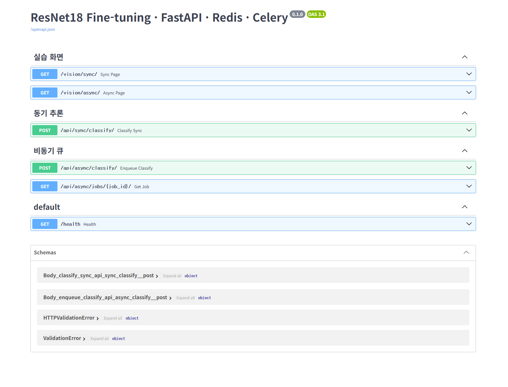
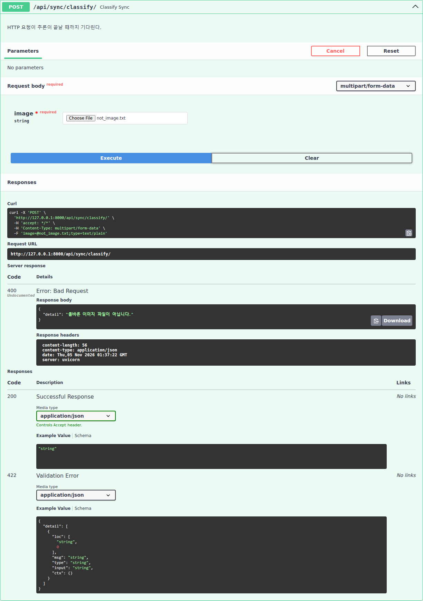
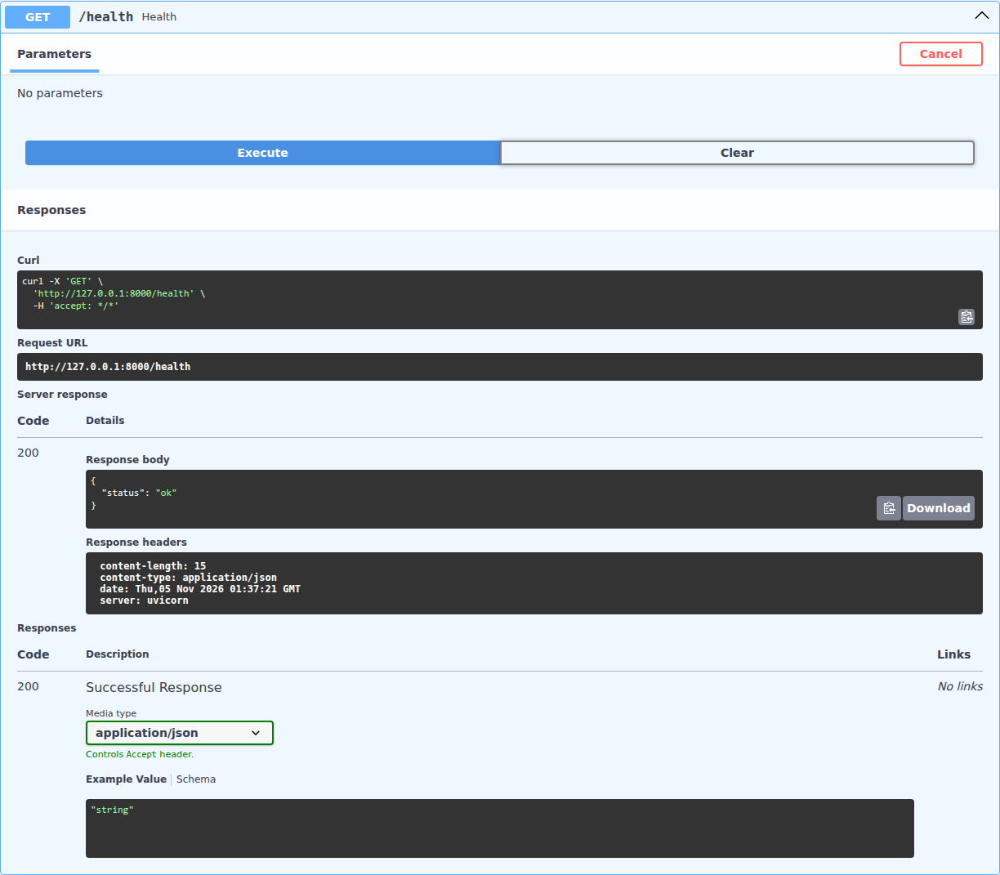

# 산출물 3. API 명세서

- Base URL: `http://127.0.0.1:8000`
- 자동 문서: `/docs` (FastAPI가 코드의 라우터·태그로 생성)



## 0. AI 추론 버튼 기준 호출 계약

화면의 버튼을 누르면 브라우저 JavaScript가 아래 API를 호출한다. 사용자는 API 주소를 직접 입력하지 않는다.

| 화면 | 사용자 동작 | 호출 API | 요청 | 성공 응답 | 화면 표시 | 실패 시 화면 |
|---|---|---|---|---|---|---|
| `/vision/sync/` | 파일 선택 (`#image`) | 없음 | — | — | 미리보기 이미지 (`URL.createObjectURL`) | — |
| `/vision/sync/` | **"동기 분류"** 버튼 (`#send`) | `POST /api/sync/classify/` (API-02) | `FormData` `image`=선택 파일 | **200** + 분류 결과 JSON | `HTTP 200 / 응답까지 ○ms` + JSON | `HTTP 400/413` + `{"detail": ...}` 표시 (화면은 상태코드를 그대로 보여 줌) |
| `/vision/async/` | **"Celery 작업 등록"** 버튼 (`#send`) | `POST /api/async/classify/` (API-03) | `FormData` `image` | **202** + `job_id`, `check_url` | `접수 완료: ○ms, job_id=N` | `등록 실패 HTTP 400/413/503` 후 폴링하지 않음 |
| `/vision/async/` | (자동) 접수 직후 1초마다 최대 60회 | `GET {check_url}` = `/api/async/jobs/{job_id}/` (API-04) | 경로의 `job_id` | **200** + `status` | `접수 ○ms / 전체 ○ms / 상태 queued·running·done` | `done`/`failed`에서 중지 |
| `/vision/async/` | **"상태조회 중지"** 버튼 (`#cancel`) | 없음 (폴링 루프만 중단) | — | — | `상태 조회만 중지했습니다(워커 작업은 계속됩니다)` | — |
| 공통 | 상단 메뉴 동기 / 비동기 / Swagger UI | `GET /vision/sync/`, `/vision/async/`, `/docs` | — | 200 HTML | 화면 이동 | — |

- 동기 버튼은 **응답 1번에 결과가 온다.** 버튼은 응답이 올 때까지 비활성화된다(`button.disabled=true`).
- 비동기 버튼은 **응답 1번(202)과 상태조회 N번**으로 나뉜다. 202는 접수일 뿐이고, 결과는 상태조회의 `done` 응답에 담겨 온다.

## 1. API 목록

| API ID | Method | URL | 요청 형태 | 성공 HTTP | 주요 응답 | 실패 HTTP | 정의 위치 |
|---|---|---|---|---:|---|---|---|
| API-01 | GET | `/health` | 없음 | 200 | `status` | 서버 미실행 시 응답 없음 | `main.py` |
| API-02 | POST | `/api/sync/classify/` | `multipart/form-data` / `image` | 200 | `model_id`, `top1`, `all`, `inference_ms`, `cache_hit` | 400, 413 | `ai/router_sync.py` |
| API-03 | POST | `/api/async/classify/` | `multipart/form-data` / `image` | 202 | `job_id`, `status`, `check_url` | 400, 413, 503 | `ai/router_async.py` |
| API-04 | GET | `/api/async/jobs/{job_id}/` | 경로 정수 `job_id` | 200 | `status`, `model_id`, `top1`, `all`, `inference_ms`, `cache_hit`, `error_message` | 404 | `ai/router_async.py` |
| WEB-01 | GET | `/vision/sync/` | 없음 | 200 | HTML | — | `ai/router_web.py` |
| WEB-02 | GET | `/vision/async/` | 없음 | 200 | HTML | — | `ai/router_web.py` |

## 2. 공통 입력 규칙 (`ai/services.py` `load_rgb_image`)

| 항목 | 규칙 | 위반 시 |
|---|---|---|
| 필드명 | `image` | 422 (FastAPI 기본 검증) |
| 크기 | 1바이트 이상, 5MB(5,242,880B) 이하 | 413 "5MB 이하 파일만 허용합니다." |
| 형식 | JPEG / PNG / WEBP (파일 내용으로 판별, 확장자 아님) | 400 "JPG, PNG, WEBP 이미지만 허용합니다." |
| 해상도 | 1,200만 픽셀 이하 | 400 |
| 디코딩 실패 | — | 400 "올바른 이미지 파일이 아닙니다." |

## 3. API-02 동기 분류

| 항목 | 내용 |
|---|---|
| URL / Method | `/api/sync/classify/` / POST |
| 동작 | 이미지 검증 → Redis 캐시 조회 → MISS면 ResNet18 추론 후 600초 캐시 저장 → **결과를 담아 응답** |
| 성공 | 200 OK |

**성공 응답 (실측, MISS)** — `evidence/ui_sync_correct.png`, `bean_rust_test.26.jpg`

```json
{
  "model_id": "artifacts/beans_resnet18",
  "top1": {"label": "bean_rust", "score": 0.4638148844242096},
  "all": [
    {"label": "bean_rust", "score": 0.4638148844242096},
    {"label": "angular_leaf_spot", "score": 0.3094010055065155},
    {"label": "healthy", "score": 0.22678400576114655}
  ],
  "inference_ms": 22.37,
  "cache_hit": false
}
```

**성공 응답 (실측, 캐시 HIT)** — `functional_tests.txt` T-09, `healthy_test.26.jpg` 재요청

```json
{
  "model_id": "artifacts/beans_resnet18",
  "top1": {"label": "healthy", "score": 0.8983675837516785},
  "all": [
    {"label": "healthy", "score": 0.8983675837516785},
    {"label": "bean_rust", "score": 0.05453498661518097},
    {"label": "angular_leaf_spot", "score": 0.04709747061133385}
  ],
  "inference_ms": null,
  "cache_hit": true
}
```

> `inference_ms: null`은 추론 시간이 0ms라는 뜻이 아니라 **모델 추론을 수행하지 않았다**는 뜻이다.

## 4. API-03 비동기 접수

| 항목 | 내용 |
|---|---|
| URL / Method | `/api/async/classify/` / POST |
| 동작 | 이미지 검증 → `media/jobs/<uuid>.bin` 저장 → `image_jobs` 행(`queued`) 생성 → `classify_job.delay(job_id)` → **즉시 응답** |
| 성공 | **202 Accepted** (작업 접수일 뿐, 분석 완료가 아님) |
| 503 | Redis 브로커 연결 실패 시 행을 `failed`로 갱신 후 503 |

**접수 응답 (실측)** — `functional_tests.txt` T-03

```text
HTTP/1.1 202 Accepted
content-type: application/json
{"job_id":11,"status":"queued","check_url":"/api/async/jobs/11/"}
```

## 5. API-04 상태 조회

| 항목 | 내용 |
|---|---|
| URL / Method | `/api/async/jobs/{job_id}/` / GET |
| 동작 | PostgreSQL `image_jobs`에서 해당 행 조회 |
| 응답 규칙 | `top1`, `all`은 `status == "done"`일 때만 값, `error_message`는 `failed`일 때만 값 |

**완료 응답 (실측, MISS)** — `evidence/ui_async.png`, job 14, `bean_rust_test.30.jpg`

```json
{
  "job_id": 14,
  "status": "done",
  "model_id": "artifacts/beans_resnet18",
  "top1": {"label": "angular_leaf_spot", "score": 0.4447840750217438},
  "all": [
    {"label": "angular_leaf_spot", "score": 0.4447840750217438},
    {"label": "bean_rust", "score": 0.40506160259246826},
    {"label": "healthy", "score": 0.15015432238578796}
  ],
  "inference_ms": 57.71,
  "cache_hit": false,
  "error_message": null
}
```

**대기 응답 (실측, Worker 정지 상태)** — `functional_tests.txt` T-10, job 12

```json
{"job_id":12,"status":"queued","model_id":"artifacts/beans_resnet18","top1":null,"all":null,"inference_ms":null,"cache_hit":null,"error_message":null}
```

> 응답 필드명은 `all`이다. `all_scores`는 DB 컬럼명이며 API 응답에서는 사용하지 않는다.

## 6. 오류 응답 (실측)

| 상황 | HTTP | 응답 본문 | 증빙 |
|---|---:|---|---|
| 이미지가 아닌 파일 (`README.md`, 비동기 API) | 400 | `{"detail":"올바른 이미지 파일이 아닙니다."}` | `evidence/bad_image.png` |
| 이미지가 아닌 파일 (`.txt`, 동기·비동기) | 400 | 동일 | `functional_tests.txt` T-07 |
| 5MB 초과 (5,242,881B) | 413 | `{"detail":"5MB 이하 파일만 허용합니다."}` | `functional_tests.txt` T-07b |
| 없는 작업번호 999999 | 404 | `{"detail":"해당 작업이 없습니다."}` | `evidence/api_404.png` |
| 브로커 연결 실패 (Redis 컨테이너 중지) | 503 | `{"detail":"작업 큐 등록 실패: Redis 연결을 확인하세요."}` — 생성된 job 15는 `failed`로 기록 | `evidence/redis_outage_test.txt` R-02, R-03 |
| (참고) Redis 중지 중 동기 분류 | **200** | 캐시 없이 추론 결과 반환 (`cache_hit:false`) — 오류가 아니라 **대체 동작** | `evidence/redis_outage_test.txt` R-01 |

| 동기 400 (Swagger) | 동기 413 (Swagger) | 헬스 체크 (Swagger) |
|---|---|---|
|  |  |  |

- 비동기 API에 잘못된 파일을 보내면 **큐 등록 전에 400으로 거절**되어 DB 행과 큐 메시지가 생기지 않는다 (테스트 후에도 `image_jobs` 14행 유지 확인).
- Swagger의 `Undocumented` 표시는 오류 응답 예시를 라우터에 등록하지 않았다는 뜻이며, 응답 자체는 코드대로 반환되었다.

## 7. 실행 근거표

| 검증 ID | 테스트 입력 | 실제 상태코드 | 첨부 증빙 |
|---|---|---:|---|
| API-01-T01 | `GET /health` | 200 | `evidence/health.png` |
| API-02-T01 | `bean_rust_test.26.jpg` | 200 | `evidence/ui_sync_correct.png` |
| API-02-T02 | `bean_rust_test.10.jpg` | 200 | `evidence/ui_sync.png` |
| API-02-T03 | `.txt` 파일 | 400 | `evidence/sync_400.png` |
| API-02-T04 | 5MB 초과 파일 | 413 | `evidence/oversize_413.png` |
| API-03-T01 | `bean_rust_test.30.jpg` | 202 | `evidence/ui_async.png` |
| API-03-T02 | `README.md` | 400 | `evidence/bad_image.png` |
| API-03-T03 | Redis 중지 후 `angular_leaf_spot_test.40.jpg` | 503 | `evidence/redis_outage.png` |
| API-02-T05 | Redis 중지 후 `healthy_test.40.jpg` | 200 (캐시 대체) | `evidence/redis_outage.png` |
| API-04-T03 | 503으로 끝난 `job_id=15` | 200 (`failed`) | `evidence/redis_outage.png`, `evidence/db_failed_row.png` |
| API-04-T01 | 접수된 `job_id=14` | 200 (`done`) | `evidence/ui_async.png` |
| API-04-T02 | 없는 `job_id=999999` | 404 | `evidence/api_404.png` |
| WEB-01/02 | `/vision/sync/`, `/vision/async/`, `/docs` | 200 | `functional_tests.txt` |

요청별 원본 응답 JSON 31개: `evidence/api/`
