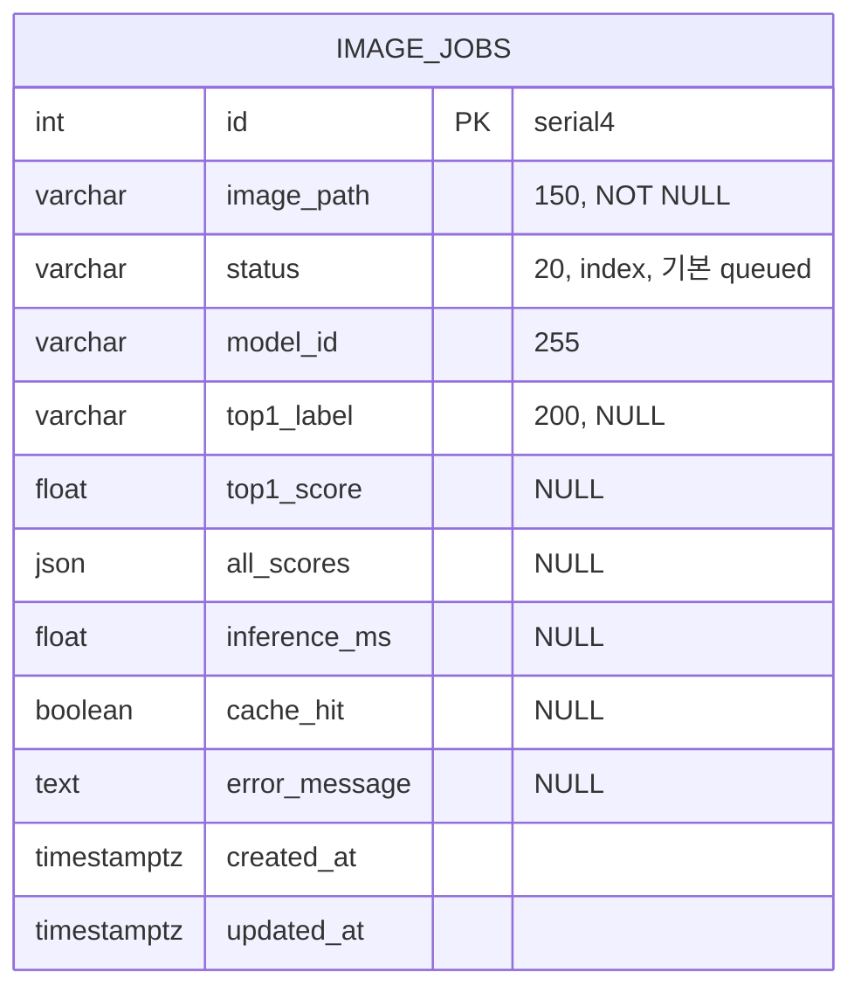
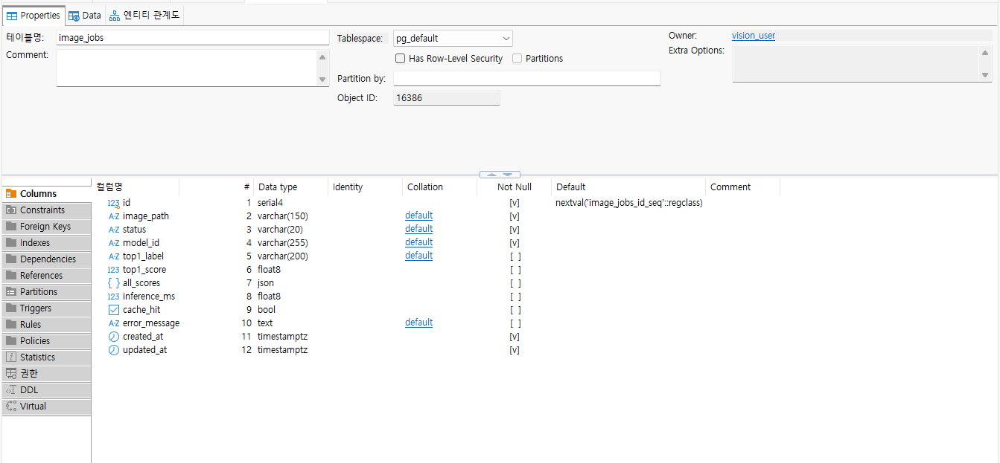
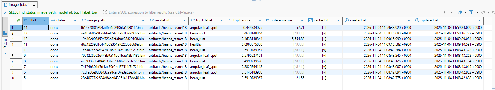
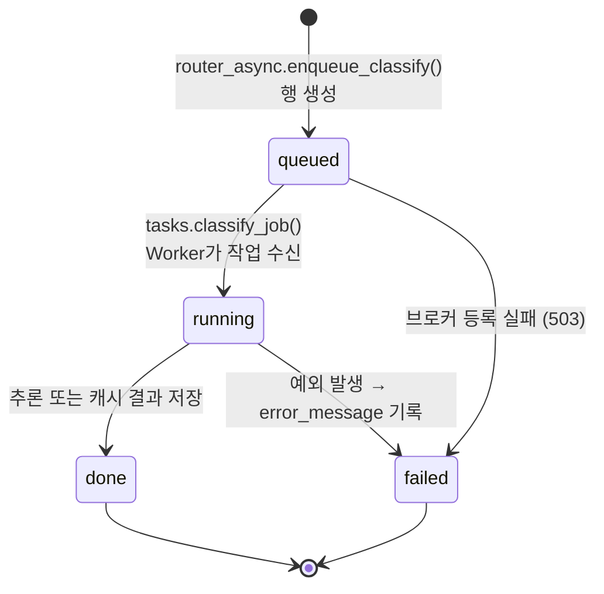

# 산출물 4. 데이터베이스 구조 및 작업이력

- DB: PostgreSQL 17 (Docker), 데이터베이스 `vision_db`, 사용자 `vision_user`
- **테이블명:** `image_jobs` · **PK:** `id` · **저장 대상:** 비동기 추론 작업의 상태 및 결과
- 테이블 생성: FastAPI 기동 시 `main.py` lifespan → `ai/database.py` `init_db()` → `Base.metadata.create_all()`
- 정의 코드: `ai/models.py` `ImageJob`

## 1. ERD



테이블이 하나뿐이므로 FK·관계 테이블은 없다 (DBeaver Foreign Keys 비어 있음).



## 2. 컬럼 정의 (DBeaver 실측 + 코드 기준)

| # | 컬럼 | DB 자료형 | Not Null / 기본값 | 실측 예시 (job 14) | 사용 이유 |
|---:|---|---|---|---|---|
| 1 | id | serial4 (INTEGER) | PK, `nextval('image_jobs_id_seq')` | 14 | 고유 작업번호, API의 `job_id` |
| 2 | image_path | varchar(150) | NOT NULL | `f614778f85894ad6b1d393bfa19801f7.bin` | `media/jobs/` 안의 원본 파일명 (사용자 파일명 미사용) |
| 3 | status | varchar(20) | NOT NULL, 코드 기본 `queued`, 인덱스 `ix_image_jobs_status` | `done` | 처리 상태 |
| 4 | model_id | varchar(255) | NOT NULL, 코드 기본 `""` | `artifacts/beans_resnet18` | 어떤 모델로 처리했는지 |
| 5 | top1_label | varchar(200) | NULL 허용 | `angular_leaf_spot` | 최종 분류 라벨 |
| 6 | top1_score | float8 | NULL 허용 | 0.444784075 | 분류 점수 |
| 7 | all_scores | json | NULL 허용 | `[{"label":"angular_leaf_spot","score":0.4448}, ...]` | 클래스별 점수 (API 응답에서는 `all`) |
| 8 | inference_ms | float8 | NULL 허용 | 57.71 | 실제 모델 추론시간 (캐시 HIT면 NULL) |
| 9 | cache_hit | bool | NULL 허용 | false | 캐시 재사용 여부 |
| 10 | error_message | text | NULL 허용 | NULL | 실패 원인 |
| 11 | created_at | timestamptz | NOT NULL, 코드 기본 UTC 현재시각 | 2026-11-04 11:59:33.920 +0900 | 작업 생성 시점 |
| 12 | updated_at | timestamptz | NOT NULL, 갱신 시 UTC 현재시각 | 2026-11-04 11:59:34.009 +0900 | 마지막 갱신 시점 |

- 기본값(`queued`, `""`, 현재시각)은 DB 컬럼 DEFAULT가 아니라 **SQLAlchemy가 INSERT 시 채우는 값**이다 (DBeaver Default 칸에는 `id`만 표시).
- DBeaver의 `+0900` 표시는 한국 시간으로 변환해 보여 준 것이며 DB에는 UTC로 저장된다.

## 3. SQL 조회 (DBeaver)

```sql
SELECT id, status, image_path, model_id, top1_label, top1_score,
       inference_ms, cache_hit, created_at, updated_at
FROM image_jobs
ORDER BY id DESC
LIMIT 10;
```



## 4. 조회 결과 기록 (전체 16행, 2026-11-04 기준)

> `db_rows.png`는 Redis 장애 테스트 전(14행)에 찍은 화면이다. 15·16행은 [`evidence/redis_outage_test.txt`](evidence/redis_outage_test.txt)의 psql 조회 결과다.

| id | status | top1_label | top1_score | inference_ms | cache_hit | 판정 |
|---:|---|---|---:|---:|---|---|
| 16 | done | healthy | 0.6068 | 76.91 | false | Redis 복구 후 정상 처리 확인 (T-11c) |
| 15 | **failed** | NULL | NULL | NULL | NULL | Redis 중지 상태에서 접수 → 큐 등록 실패, `error_message`="작업 큐 등록 실패: Redis 연결을 확인하세요." (T-11, HTTP 503) |
| 14 | done | angular_leaf_spot | 0.4448 | 57.71 | false | 비동기 추론 완료 (`ui_async.png`) |
| 13 | done | bean_rust | 0.4638 | NULL | true | 동기에서 저장한 캐시를 Worker가 재사용 (`cache.png`) |
| 12 | done | bean_rust | 0.4638 | 5,554.82 | false | Worker 정지 중 접수 → 재시작 후 완료, 모델 최초 로딩 포함 (T-10) |
| 11 | done | healthy | 0.8984 | NULL | true | 동기 T-02 결과를 재사용 (T-03/T-04) |
| 6~10 | done | — | — | NULL | true | 성능 측정 비동기 HIT 그룹 5건 |
| 2~5 | done | — | — | 17.82~24.39 | false | 성능 측정 비동기 MISS 그룹 |
| 1 | done | angular_leaf_spot | 0.5146 | 5,596.06 | false | 성능 측정 MISS 1회차, **Worker 모델 최초 로딩 포함** |

| 상태 | 건수 | 비고 |
|---|---:|---|
| done | 15 | 그중 cache_hit=true 7건 |
| queued / running | 0 | 최종 상태 기준 (job 12는 Worker 정지 중 `queued` 관찰 후 `done`) |
| **failed** | **1** | job 15 — 브로커 등록 실패(`queued → failed`). Worker 추론 중 예외로 인한 `running → failed`는 실환경 미발생, 모의 테스트 `test_worker_failure_records_failed`에서만 확인 |

## 5. 상태 전이와 저장 규칙



| 항목 | 내용 |
|---|---|
| 상태 전이 | `queued → running → done` / 오류 시 `failed` |
| `running` 관찰 | 작업이 수십 ms 안에 끝나 화면·DB에서 직접 보지 못함. 정상 완료는 최종 `done`, Worker 로그(`received` → `succeeded`)로 판단 |
| 이미지 실제 저장 위치 | `media/jobs/<uuid>.bin` (16개 파일, DB에는 원본 바이너리 미저장. 503으로 실패한 job 15도 파일은 먼저 저장됨) |
| 동기 요청의 DB 행 | 기본 제공 코드에서는 **생성하지 않음** |
| 중복 처리 방지 | `tasks.py`에서 이미 `done`인 작업은 다시 처리하지 않음 |

**증빙:** [`evidence/db_schema.png`](evidence/db_schema.png), [`evidence/db_rows.png`](evidence/db_rows.png), [`evidence/functional_tests.txt`](evidence/functional_tests.txt) (psql 조회·`\d image_jobs` 원문)
