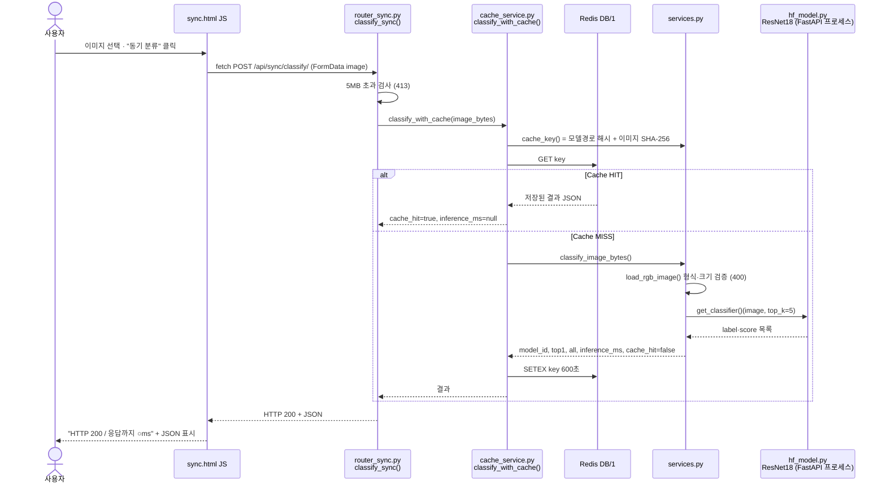
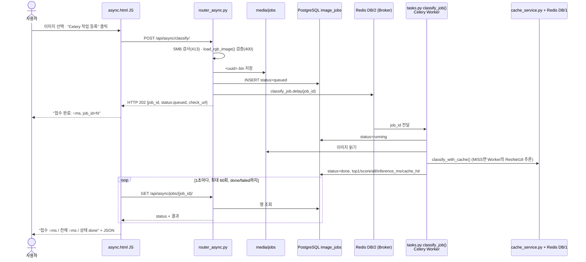
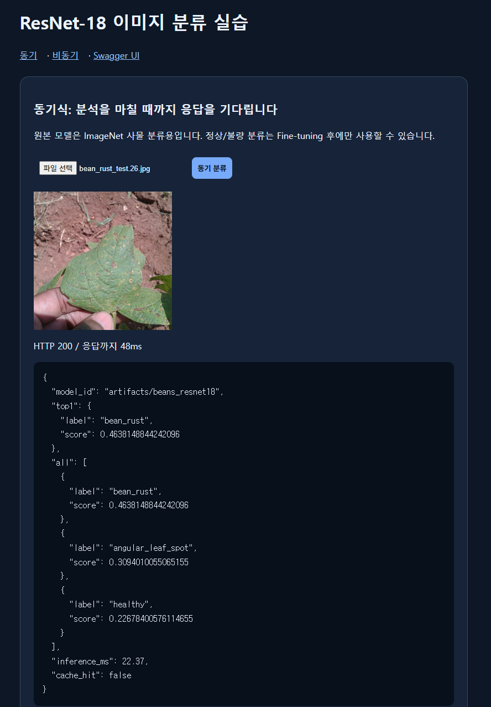
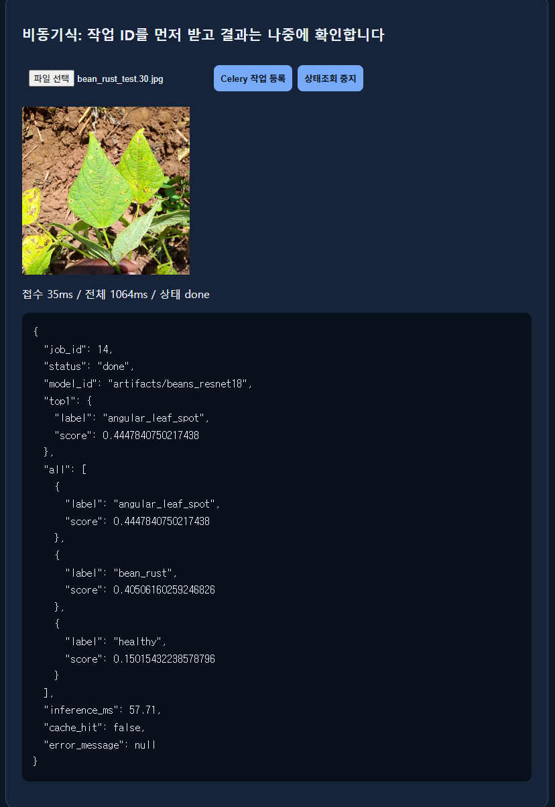
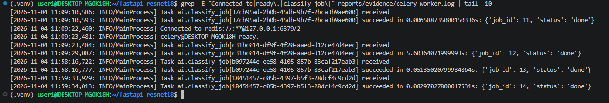
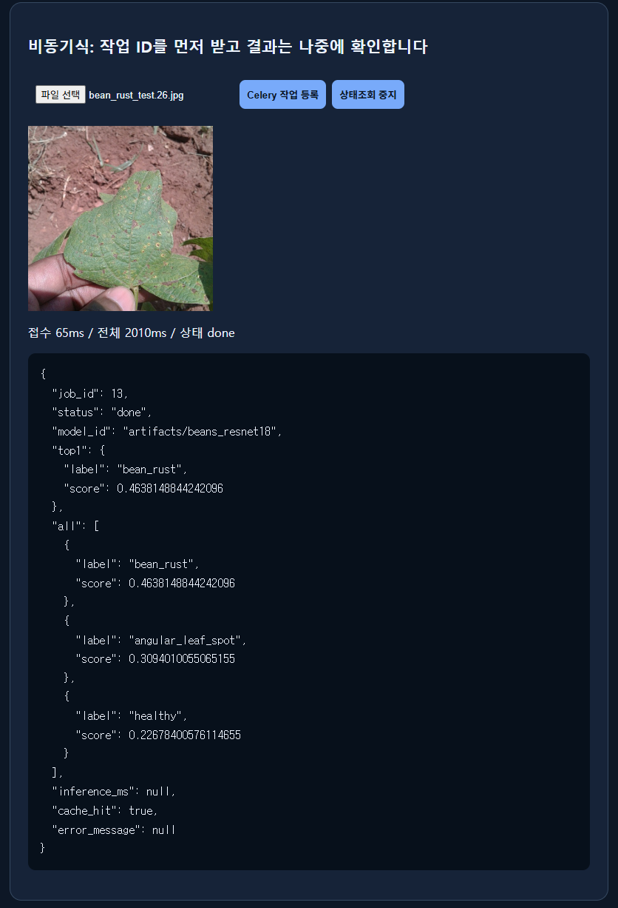

# 산출물 5. AI 분석 버튼 처리 파이프라인

## A. 동기 버튼 클릭 시퀀스 (`/vision/sync/` → "동기 분류")

## B. 비동기 버튼 클릭 시퀀스 (`/vision/async/` → "Celery 작업 등록")

## C. 함수 기준 파이프라인 (입력 → 처리 → 출력)

### C-1. 동기 버튼

| 단계 | 파일 · 함수 | 입력 | 처리 | 출력 → 다음 함수 | 예외 분기 |
|---:|---|---|---|---|---|
| S1 | `templates/sync.html` `send.onclick` | 사용자가 고른 `File` | `FormData`에 `image`로 담아 `fetch` POST, 시작 시각 기록 | HTTP 요청 → S2 | 파일 미선택 시 `alert` 후 중단, 네트워크 오류 시 `요청 실패` 표시 |
| S2 | `ai/router_sync.py` `classify_sync(image: UploadFile)` | multipart 파일 | `image.file.read(MAX_UPLOAD_BYTES + 1)`로 최대 5MB+1B만 읽음 | `image_bytes: bytes` → S3 | 5MB 초과 → **413** / S5의 `InvalidImage` → **400** |
| S3 | `ai/cache_service.py` `classify_with_cache(image_bytes)` | `bytes` | `cache_key()` 생성 → `get_redis().get(key)` | HIT: 저장 JSON에 `cache_hit=True`, `inference_ms=None` 덮어써 반환 / MISS → S4 | Redis 조회 실패 → 경고 로그 후 S4로 진행 (중단 없음) |
| S3a | `ai/services.py` `cache_key(image_bytes)` | `bytes` | `sha256(이미지)` + `sha256(MODEL_PATH)[:16]` | `"vision:classify:{모델해시}:{이미지해시}"` | — |
| S4 | `ai/services.py` `classify_image_bytes(image_bytes)` | `bytes` | S5 호출 → 시간 측정 시작 → S6 호출 → 중첩 리스트 정리 → 점수 내림차순 정렬 | `dict{model_id, top1, all, inference_ms, cache_hit=False}` → S3로 반환 | 모델 결과가 비면 `RuntimeError` |
| S5 | `ai/services.py` `load_rgb_image(image_bytes)` | `bytes` | `Image.open` → 형식(JPEG/PNG/WEBP)·픽셀 수(1,200만) 검사 → EXIF 회전 보정 → RGB 변환 | `PIL.Image` (RGB) | 빈 파일·형식·해상도·디코딩 실패 → `InvalidImage` |
| S6 | `ai/hf_model.py` `get_classifier()` | 없음 (`MODEL_PATH`) | 첫 호출에만 `pipeline("image-classification", model=MODEL_PATH, device=-1)` 생성, `lru_cache`로 재사용 | 분류기 객체 → `(image, top_k=5)` 호출 시 `[{label, score}, ...]` | 첫 호출은 모델 로드로 약 5.5초 |
| S7 | `cache_service.classify_with_cache` (계속) | S4 결과 `dict` | `setex(key, 600, json)` | 결과 `dict` → S2 → FastAPI가 JSON 직렬화, **200** | Redis 저장 실패 → 경고 로그, 결과는 그대로 반환 |
| S8 | `sync.html` | 응답 | `res.json()` 표시, 경과 ms 계산 | 화면 `HTTP 200 / 응답까지 ○ms` | 4xx도 상태코드와 `detail`을 그대로 표시 |

### C-2. 비동기 버튼

| 단계 | 파일 · 함수 | 입력 | 처리 | 출력 → 다음 함수 | 예외 분기 |
|---:|---|---|---|---|---|
| A1 | `templates/async.html` `send.onclick` | `File` | POST `/api/async/classify/` | HTTP 요청 → A2 | `!res.ok` → `등록 실패 HTTP ○○○` 표시 후 폴링하지 않음 |
| A2 | `ai/router_async.py` `enqueue_classify(image)` | multipart 파일 | ① 5MB 검사 ② `load_rgb_image()`로 **큐 등록 전 검증** ③ `uuid4().hex + ".bin"`으로 `media/jobs`에 저장 ④ `ImageJob(status="queued", model_id=MODEL_PATH)` INSERT → `job_id` ⑤ `classify_job.delay(job_id)` | **202** `{job_id, status:"queued", check_url}` | 413 / 400 (파일·DB 미생성) / `delay` 실패 → 행을 `failed`로 갱신 후 **503** |
| A3 | `ai/celery_app.py` `celery_app` | `job_id` (JSON 직렬화) | Redis DB/2 큐에 메시지 적재 | Worker가 수신 → A4 | 브로커 끊김 시 Worker 자동 재연결 |
| A4 | `ai/tasks.py` `classify_job(job_id)` | `int job_id` | `db.get(ImageJob)` → `status="running"` commit → `media/jobs/<image_path>` 읽기 → `classify_with_cache()` (S3~S7과 동일, Worker 프로세스의 모델 사용) → 결과 컬럼 저장, `status="done"` commit | `{"job_id", "status": "done"}` → Redis DB/3 (결과 백엔드) | 행 없음 → `job_not_found` 반환 / 이미 `done` → 재처리 생략 / 예외 → `rollback` → `failed` + `error_message`(최대 1,500자) commit → 예외 재발생 |
| A5 | `ai/router_async.py` `get_job(job_id)` | 경로 `int` | `db.get(ImageJob, job_id)` | **200** `{job_id, status, model_id, top1, all, inference_ms, cache_hit, error_message}` (`top1`/`all`은 `done`일 때만, `error_message`는 `failed`일 때만) | 행 없음 → **404** |
| A6 | `async.html` 폴링 루프 | `check_url` | `sleep(1000)` 후 GET, 최대 60회 | `done`/`failed`면 중지, 화면 갱신 | "상태조회 중지" → 루프만 종료 (Worker 작업은 계속) |

### C-3. 서버 기동 시 1회

| 파일 · 함수 | 처리 |
|---|---|
| `main.py` `lifespan()` → `ai/database.py` `init_db()` | `models` 등록 후 `Base.metadata.create_all()` → `image_jobs` 테이블이 없으면 생성. PostgreSQL이 꺼져 있으면 서버 기동 실패 |
| `main.py` `app.mount("/static")`, `include_router(web/sync/async)` | 정적 파일·라우터 등록 → Swagger 자동 생성 |

## D. 실제 실행으로 확인한 흐름

| 확인 | 화면·로그 | 내용 |
|---|---|---|
| 동기 MISS |  | `HTTP 200 / 응답까지 48ms`, `inference_ms: 22.37`, `cache_hit: false` |
| 비동기 MISS |  | `접수 35ms / 전체 1064ms / 상태 done`, job 14, `inference_ms: 57.71` |
| Worker 처리 |  | `11:59:33,929 received` → `11:59:34,013 succeeded in 0.083s: {'job_id': 14, 'status': 'done'}` |
| 캐시 공유 |  | 동기로 보낸 이미지를 비동기로 보내자 job 13이 `cache_hit: true`, Worker 처리 0.051s |

- 비동기 화면의 "전체" 시간은 브라우저의 **1초 폴링 간격**에 맞춰 늘어난다. Worker의 실제 처리는 job 14 기준 0.083초였다. 정밀 측정은 [산출물 6](06_성능비교_보고서.md) 참고.

## E. 비교 결론

- **동기:** HTTP 응답을 받는 순간 추론 결과가 함께 온다. 요청이 추론이 끝날 때까지 대기한다.
- **비동기:** HTTP 202로 **접수만** 먼저 받고, 결과는 `job_id`로 별도 조회해야 한다. 추론은 FastAPI가 아닌 Celery Worker 프로세스에서 실행된다.
- **공통:** 분류를 수행하는 모델(`artifacts/beans_resnet18`)과 Redis 캐시는 동일하다. 같은 이미지는 동기·비동기 어느 쪽으로 보내도 같은 결과(job 12·13과 동기 결과 모두 bean_rust 0.4638)를 얻었다.
