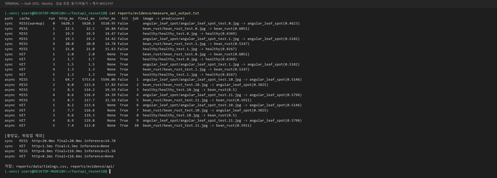

# 산출물 6. 성능 측정 및 비교 보고서

## 1. 실험 조건

| 조건 | 값 |
|---|---|
| 측정 일시 | 2026-11-04 11:08 KST |
| 측정 도구 | `tools/measure_api.py` (**추가 작성한 측정 스크립트, 제공 코드 아님**) — httpx로 실제 서버에 요청 |
| 모델 | `artifacts/beans_resnet18` (Head-only, 모든 측정 동일 체크포인트) |
| 추론 장치 | CPU (`hf_model.py` `device=-1`), Intel Core i7-12700 / WSL 15GiB |
| 실행환경 | FastAPI·Celery: WSL2 Ubuntu 26.04 `.venv` / Redis·PostgreSQL: Docker |
| Worker | `--pool=solo --concurrency=1` |
| 이미지 | `dataset/test`의 서로 다른 JPEG 파일 (500×500), 파일별 SHA-256 앞 12자리를 CSV에 기록. **Test 정확도 산출 목적 아님** |
| 반복 | 조건별 5회 |
| 캐시 | 측정 시작 시 Redis **DB/1(캐시)만** 비움. MISS 그룹 = 처음 보내는 이미지, HIT 그룹 = 같은 이미지를 바로 재전송 |
| 워밍업 | 프로세스별 모델 최초 로드를 비교에서 제외 — FastAPI 첫 요청은 `run_id=0`으로 별도 기록, Worker 첫 작업(비동기 MISS 1회차)도 제외 |
| `http_ms` | 클라이언트가 POST를 보내고 HTTP 응답을 받을 때까지 |
| `final_ms` | 동기 = `http_ms` / 비동기 = 접수 POST 시작 ~ 상태조회에서 `done` 확인까지 (**0.1초 간격 폴링 포함**, 브라우저 화면의 1초 폴링과 다름) |
| `inference_ms` | 서버가 응답한 모델 추론시간 (캐시 HIT는 null) |

## 2. 원본 측정표 (단위 ms, 원본: [`data/timings.csv`](data/timings.csv))

### 2-1. MISS (모델 추론 수행)

| 반복 | Sync HTTP·전체 | Sync 추론 | Async 접수 HTTP | Async 최종 확인 | Async 추론 | job_id |
|---:|---:|---:|---:|---:|---:|---:|
| 워밍업 | *5,620.3* | *5,510.95* | — | — | — | — |
| 1 | 22.5 | 16.84 | *64.7* | *5,753.6* | *5,596.06* | 1 (Worker 워밍업, 제외) |
| 2 | 19.9 | 14.47 | 8.0 | 113.6 | 17.82 | 2 |
| 3 | 19.3 | 14.42 | 8.3 | 114.2 | 19.59 | 3 |
| 4 | 20.0 | 14.78 | 8.6 | 116.9 | 24.39 | 4 |
| 5 | 21.0 | 15.63 | 8.7 | 117.7 | 21.56 | 5 |
| **중앙값** | **20.0** (n=5) | **14.78** | **8.45** (n=4) | **115.55** (n=4) | **20.58** (n=4) | |

### 2-2. HIT (캐시 재사용, 추론 생략)

| 반복 | Sync HTTP·전체 | Async 접수 HTTP | Async 최종 확인 | job_id |
|---:|---:|---:|---:|---:|
| 1 | 2.0 | 8.2 | 113.6 | 6 |
| 2 | 1.7 | 7.7 | 116.6 | 7 |
| 3 | 1.5 | 9.6 | 119.3 | 8 |
| 4 | 1.3 | 8.9 | 119.8 | 9 |
| 5 | 1.3 | 7.4 | 113.0 | 10 |
| **중앙값** | **1.5** | **8.2** | **116.6** | |

측정 실행 화면 (`tools/measure_api.py` 출력):



## 3. 계산

```text
[동기 vs 비동기, MISS 대 MISS]
HTTP 응답시간 감소율 = (20.0 − 8.45) / 20.0 × 100 = 57.75 %   (비동기 '접수'가 더 빨리 반환)
결과 확인시간 차이   = 115.55 − 20.0 = 95.55 ms               (비동기 최종 확인이 더 느림)

[동기 캐시 MISS vs HIT]
HTTP 응답시간 감소율 = (20.0 − 1.5) / 20.0 × 100 = 92.5 %
```

## 4. 캐시 비교표 (중앙값)

| 경로 | 캐시 | HTTP 응답 (ms) | 최종 결과 확인 (ms) | 추론시간 (ms) | 메모 |
|---|---|---:|---:|---:|---|
| 동기 | MISS | 20.0 | 20.0 | 14.78 | 모델 실제 추론 |
| 동기 | HIT | 1.5 | 1.5 | null | 모델 추론 생략 |
| 비동기 | MISS | 8.45 (접수) | 115.55 | 20.58 | Worker에서 추론 |
| 비동기 | HIT | 8.2 (접수) | 116.6 | null | Worker가 캐시 재사용 |
| (참고) 모델 최초 로드 | MISS | 5,620.3 | — | 5,510.95 / 5,596.06 | FastAPI / Worker 각각 1회 |

## 5. 해석

1. **비동기 접수 HTTP 응답은 동기 결과 응답보다 57.75% 빨리 반환되었다.** 이는 **모델 추론이 빨라졌다는 뜻이 아니라**, 요청 접수와 실제 처리를 분리한 효과다. 비동기 추론시간(20.58ms)은 동기(14.78ms)와 같은 수준이다.
2. **최종 결과를 받기까지는 비동기가 약 95ms 더 느렸다.** 큐 전달, DB 상태 갱신, 상태조회 폴링(0.1초 간격) 대기가 추가되기 때문이다. 실제 Worker 처리 자체는 수십 ms이며(예: job 14 `succeeded in 0.083s`), 비동기 최종 확인값 113~120ms는 대부분 **첫 폴링 시점(약 0.1초 뒤)에 결정**된다.
3. **동기 경로에서 캐시 HIT는 HTTP 응답을 92.5% 줄였다** (20.0 → 1.5ms). `inference_ms=null`은 추론을 생략했다는 뜻이며 0ms가 아니다.
4. **비동기에서는 캐시 HIT와 MISS의 최종 확인시간 차이가 측정되지 않았다** (115.55 vs 116.6ms). 추론 절감분(약 20ms)이 0.1초 폴링 간격보다 작아 이 측정 방식으로는 구분되지 않는다. Worker 로그 기준 처리시간은 HIT 0.005~0.05초, MISS 수십 ms다.
5. **모델 최초 로드(약 5.5초)가 단일 추론(약 15~20ms)보다 수백 배 크다.** FastAPI와 Worker가 각자 모델을 로드하므로 각 프로세스의 첫 요청이 느리다. 서비스에서는 기동 직후 워밍업 요청이 필요하다.
6. 이 수치는 CPU 추론, 500×500 이미지, 단일 사용자, 로컬 환경 기준이며 동시 접속 부하는 측정하지 않았다.

## 6. 비교 조건 점검

- [x] 같은 모델 체크포인트(`artifacts/beans_resnet18`)로 측정
- [x] MISS 대 MISS, HIT 대 HIT 구분
- [x] 같은 해상도(Test JPEG 500×500)·하드웨어·실행환경
- [x] 모델 첫 로딩·워밍업 별도 기록 후 제외 (FastAPI 1건, Worker 1건)
- [x] 반복 원본값(`data/timings.csv`)과 요약표 일치
- [ ] 동시 요청 부하 측정 — 미실시

## 7. 성능 향상 주장 범위

- 본 보고서의 "빠르다"는 **HTTP 응답·결과 확인 시간**에 대한 것이며 분류 정확도와는 다른 지표다.
- 모델 정확도 개선 실험은 수행하지 않았다 ([산출물 8](08_최종기술보고서.md) 8장: 제안).

**증빙:** [`data/timings.csv`](data/timings.csv), [`evidence/measure_api_output.txt`](evidence/measure_api_output.txt), [`evidence/perf_result.png`](evidence/perf_result.png), [`evidence/api/`](evidence/api/), [`evidence/cache.png`](evidence/cache.png)
