# 산출물 7. 기능 테스트 및 오류 분석 기록서

- 실행 일시: 2026-11-04 11:09 KST (화면 캡처는 11:40~12:10)
- 대상: 실제 ResNet18(`artifacts/beans_resnet18`) + Redis + PostgreSQL + Celery Worker + FastAPI
- 원본 기록: [`evidence/functional_tests.txt`](evidence/functional_tests.txt), Redis 장애 테스트(12:52 KST) [`evidence/redis_outage_test.txt`](evidence/redis_outage_test.txt)

## 1. 실환경 통합 테스트

| Test ID | 확인 항목 | 테스트 입력·절차 | 기대 결과 | 실제 결과 | 판정 | 증빙 |
|---|---|---|---|---|---|---|
| T-01 | FastAPI 헬스 | GET `/health` | 200 / ok | 200 `{"status":"ok"}` | PASS | `health.png` |
| T-01b | 화면·문서 | GET `/vision/sync/`, `/vision/async/`, `/docs` | 200 | 200 / 200 / 200 | PASS | `swagger.png` |
| T-02 | 모델 동기 추론 | `bean_rust_test.26.jpg` 업로드 | 200 / 3클래스 JSON | 200 / bean_rust 0.4638, `cache_hit:false` | PASS | `ui_sync_correct.png` |
| T-02b | 모델 동기 추론 (오분류 사례) | `bean_rust_test.10.jpg` 업로드 | 200 / 3클래스 JSON | 200 / angular_leaf_spot 0.3825 (폴더 라벨과 불일치) | PASS (기능) | `ui_sync.png` |
| T-03 | 비동기 접수 | `bean_rust_test.30.jpg` 업로드 | 202 / job_id | 202 / job_id 14 | PASS | `ui_async.png` |
| T-04 | 비동기 완료 | GET `/api/async/jobs/14/` (화면 폴링) | 200 / done | 200 / done, angular_leaf_spot 0.4448, `inference_ms` 57.71 | PASS | `ui_async.png`, `celery_log.png` |
| T-05 | Redis 연결 | `docker compose exec redis redis-cli ping` | PONG | PONG | PASS | `docker_ps.png` |
| T-05b | PostgreSQL 연결 | `pg_isready -U vision_user -d vision_db` | accepting | accepting connections | PASS | `docker_ps.png` |
| T-06 | DB 기록 | DBeaver `image_jobs` 조회 | id=14, done | id=14, done (캡처 시점 14행 모두 done, 장애 테스트 후 16행) | PASS | `db_rows.png`, `db_schema.png` |
| T-07 | 불량 입력 | `.txt` 업로드 (동기·비동기) / `README.md` 업로드 (비동기, Swagger) | 400 | 400 "올바른 이미지 파일이 아닙니다." | PASS | `bad_image.png`(비동기), `sync_400.png`(동기) |
| T-07b | 크기 초과 | 5,242,881B 파일 업로드 | 413 | 413 "5MB 이하 파일만 허용합니다." | PASS | `oversize_413.png` |
| T-08 | 없는 작업번호 | GET `/api/async/jobs/999999/` | 404 | 404 "해당 작업이 없습니다." | PASS | `api_404.png` |
| T-09 | 캐시 반복 | 같은 파일 2회 요청 (동기) | MISS → HIT | `cache_hit` false → true, `inference_ms` 18.42 → null | PASS | `functional_tests.txt` |
| T-09b | 캐시 공유 | 동기로 보낸 `bean_rust_test.26.jpg`를 비동기로 전송 | Worker가 캐시 재사용 | job 13 `cache_hit:true`, Worker 0.051s | PASS | `cache.png` |
| T-10 | Worker 미실행 | Worker 종료 → 접수 → 5초 대기 → Worker 재실행 | 대기 후 처리 | 202 → 5초 후 `queued` (브로커 큐 길이 1) → 재실행 9초 후 `done` (job 12) | PASS | `worker_stopped.png`, `celery_log.png` |
| T-11 | 브로커 장애 | `docker compose stop redis` 후 비동기 접수 | 503 + DB `failed` | 503 (0.68초) / job 15 `failed`, `error_message`="작업 큐 등록 실패: Redis 연결을 확인하세요." | PASS | `redis_outage.png`, `db_failed_row.png` |
| T-11b | 캐시 장애 대체 | Redis 중지 상태에서 동기 분류 | 200 (캐시 없이 추론) | 200 (0.18초), `cache_hit:false`, 로그 `Redis 조회 불가; 모델 추론으로 전환` | PASS | `redis_outage.png` |
| T-11c | 장애 복구 | `docker compose start redis` 후 비동기 접수 | Worker 재연결, `done` | Worker `Connected to redis://.../2` (약 2초 후) → job 16 `done` | PASS | `redis_recovery.png` |
| T-12 | Worker 추론 중 예외 | 추론 도중 예외 | DB `failed` + error_message | **실환경 미발생** (모의 테스트에서만 확인) | — | `pytest_mock.txt` |

## 2. 단위·모의 테스트 (실환경과 구분)

`tests/test_api.py` — 가짜 모델·SQLite·브로커 스텁을 사용. **실제 ResNet18·Redis·PostgreSQL·Celery 동작은 검증하지 않는다.**

| 테스트 | 확인 내용 | 결과 |
|---|---|---|
| `test_end_to_end` | health·화면·정적파일 200, 동기 200/400/413, 비동기 202 → queued → done, 404 | PASS |
| `test_broker_failure` | 브로커 연결 실패 시 503 | PASS |
| `test_cache_hit_avoids_repeated_inference` | 같은 바이트 2회 → 두 번째 HIT, 추론 1회 | PASS |
| `test_worker_failure_records_failed` | Worker 예외 시 `failed` + `error_message` 기록 | PASS |

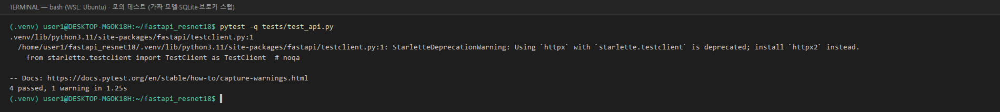

- 경고 1건은 `starlette.testclient`의 httpx 사용 지원 종료 예고(`StarletteDeprecationWarning`)이며 결과에 영향 없음.
- 503(`test_broker_failure`)은 실환경 T-11에서도 확인했다. Worker 추론 중 예외(`test_worker_failure_records_failed`)는 **모의 테스트에서만 PASS**이므로 실환경 PASS로 기록하지 않는다.
- 원본: [`evidence/pytest_mock.txt`](evidence/pytest_mock.txt)

## 2-1. 예외처리 설계 (코드 기준)

실패를 **어디서 잡고, 사용자에게 무엇을 돌려주고, 기록을 어떻게 남기는지** 정리했다.

| # | 실패 상황 | 잡는 위치 (파일 · 함수) | 처리 방식 | 사용자 응답 | 기록 | 실환경 검증 |
|---:|---|---|---|---|---|---|
| X-1 | 5MB 초과 업로드 | `router_sync.classify_sync`, `router_async.enqueue_classify` | `read(MAX+1)`로 끝까지 읽지 않고 초과만 판정 | **413** "5MB 이하 파일만 허용합니다." | — | T-07b |
| X-2 | 비이미지·깨진 파일·허용 외 형식·1,200만 픽셀 초과·빈 파일 | `services.load_rgb_image` | `UnidentifiedImageError`·`OSError`·`DecompressionBombError`를 `InvalidImage`로 변환해 던짐 → 라우터가 `HTTPException(400)`으로 변환 | **400** 원인별 메시지 | 비동기는 **큐 등록 전에 거절** → 파일·DB 행 미생성 | T-07 (DB 행 수 변화 없음 확인) |
| X-3 | Redis 캐시 조회 실패 | `cache_service.classify_with_cache` | `except Exception` → `log.warning` 후 **모델 추론으로 전환** (연결 타임아웃 1초) | **200** (`cache_hit:false`) — 서비스 중단 없음 | FastAPI 로그 경고 | T-11b |
| X-4 | Redis 캐시 저장 실패 | `cache_service.classify_with_cache` | `except Exception` → 경고 후 결과는 그대로 반환 | 200 | 로그 경고 | T-11b |
| X-5 | 브로커(Redis DB/2) 등록 실패 | `router_async.enqueue_classify` | `classify_job.delay()` 예외 → 이미 만든 행을 `failed` + 메시지로 갱신 | **503** "작업 큐 등록 실패: Redis 연결을 확인하세요." | DB `failed` (job 15) | T-11 |
| X-6 | Worker 미실행 | (코드 처리 없음, 구조상) | 메시지가 Redis 큐에 남아 대기 | 202 후 `queued` 유지 | 큐 길이 1 | T-10 |
| X-7 | 브로커 연결 끊김 (Worker 측) | Celery 내부 | `Connection to broker lost. Trying to re-establish` → 자동 재연결 | — | Worker 로그 WARNING·Traceback | T-11c |
| X-8 | Worker 추론 중 예외 (파일 없음, 모델 오류 등) | `tasks.classify_job` | `db.rollback()` → 행 재조회 → `failed` + `"{예외타입}: {메시지}"`(최대 1,500자) commit → `raise`로 Celery에도 실패 전달 | 상태조회 시 `failed` + `error_message` | DB + Celery 로그 | 모의 테스트만 |
| X-9 | 존재하지 않는 job_id 처리 (Worker) | `tasks.classify_job` | `{"error": "job_not_found"}` 반환, 예외 없음 | — | Celery 결과 | 미실시 |
| X-10 | 같은 작업 중복 실행 | `tasks.classify_job` | 이미 `done`이면 재처리하지 않고 반환 | — | — | 미실시 |
| X-11 | 없는 job_id 조회 | `router_async.get_job` | `HTTPException(404)` | **404** "해당 작업이 없습니다." | — | T-08 |
| X-12 | 브라우저 쪽 실패 | `sync.html`, `async.html` | 파일 미선택 `alert`, `fetch` 예외 `요청 실패: ...`, 비동기 4xx/5xx면 폴링 중단 | 화면 메시지 | — | T-07, T-11 화면 동작 |

**처리하지 않는 경우 (한계)**
- 동기 경로에서 모델 자체가 실패(`RuntimeError` 등)하면 라우터가 잡지 않아 **500**이 된다. 실환경에서는 발생하지 않았다.
- PostgreSQL이 꺼져 있으면 서버 기동(`init_db`) 또는 비동기 접수가 실패한다. 별도 예외 메시지는 없다. 실환경 미실시.
- 브로커 장애로 503이 난 작업(job 15)은 자동 재시도하지 않는다. 사용자가 다시 등록해야 한다.

## 3. 오류 이력 (실제 경험)

| 오류 ID | 현상 | 원인 확인 | 조치 | 재검증 | 결과 |
|---|---|---|---|---|---|
| E-01 | 01 문서의 `python3.11 -m venv` 실행 불가 | WSL Ubuntu 26.04에 Python 3.14만 있고 3.11 apt 패키지 없음 | `uv python install 3.11` 후 `uv venv --python 3.11 .venv` | `python --version` → 3.11.18, 패키지 설치·모의 테스트 4 passed | 해결 |
| E-02 | `train.zip`의 healthy 항목이 342개인데 복사 결과는 341장 | 확장자 `.120tore` 파일 1개, 헤더 `Bud1` → macOS 메타데이터 파일 | 이미지가 아니므로 제외 (학습 코드도 이미지 확장자만 읽음) | 원본·실행용 폴더 개수 일치, 학습 로그 `Train: 1034` | 해결 |
| E-03 | 비동기 MISS 1회차가 5.75초로 다른 회차(약 0.11초)보다 50배 느림 | Worker 프로세스가 첫 작업에서 모델을 로드 (`inference_ms` 5,596.06) | 워밍업으로 분류해 성능 비교에서 제외 | 2~5회차 113~118ms로 안정 | 측정 조건에 반영 |
| E-04 | 화면에서 이전에 보낸 이미지가 `cache_hit:false`로 다시 추론됨 | 캐시 TTL 600초(`setex(key, 600, ...)`) 만료 | 정상 동작으로 판단 | 직후 재전송 시 `cache_hit:true` | 정상 |
| — | `queued` 상태가 계속 유지 | (T-10에서 의도적으로 재현) Worker 미실행 | Worker 재실행 | 같은 job 12 재조회 | `done` 확인 |

- T-10에서는 Worker를 재실행하자 브로커에 남아 있던 작업이 처리되었다. 다만 브로커 메시지가 사라지는 경우 등 **항상 기존 작업이 처리된다고 보장하지 않으므로** 실제 로그·큐 상태·결과로 확인해야 한다.
- 정상 테스트 구간(Redis 장애 테스트 전)에는 FastAPI·Worker 로그에 `ERROR`/`Traceback`이 0건이었다. Worker 로그의 Traceback은 모두 T-11에서 Redis를 의도적으로 멈춘 시점(12:52:53)의 연결 끊김 기록이다.

## 4. 실행 캡처

캡처는 모두 24장이다(`evidence/*.png`). 장애 테스트 화면은 테스트 당시 저장한 기록 파일(`functional_tests.txt`, `redis_outage_test.txt`)의 내용이다.

| 화면 | 이미지 |
|---|---|
| 헬스 체크 | 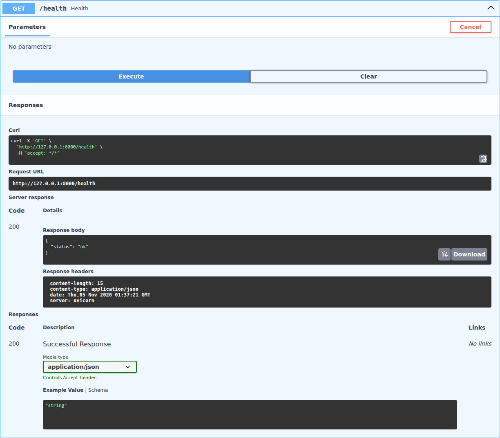 |
| 동기 400 | 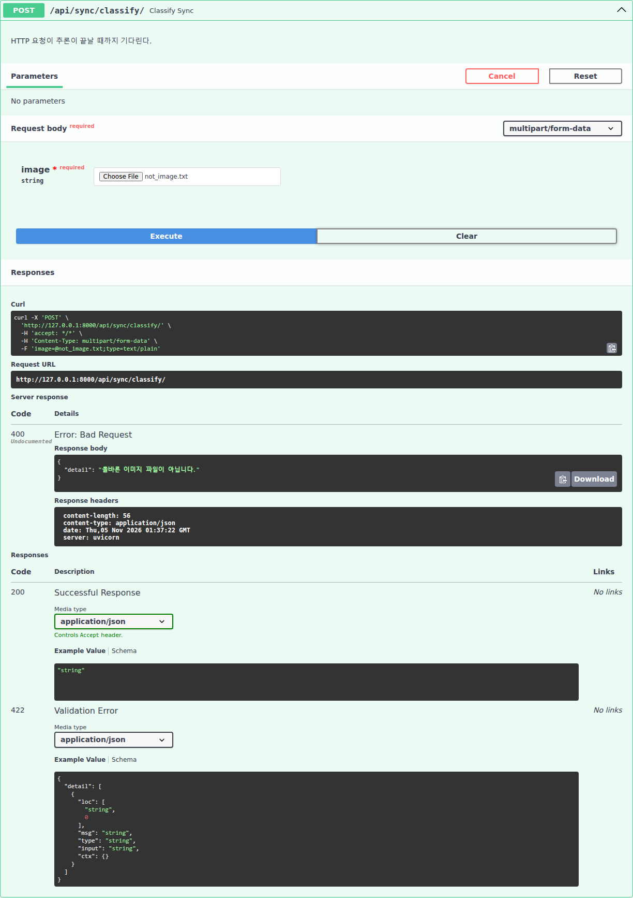 |
| 413 크기 초과 |  |
| Worker 정지 → queued → 복구 | 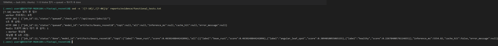 |
| Redis 장애 (동기 200, 비동기 503) | 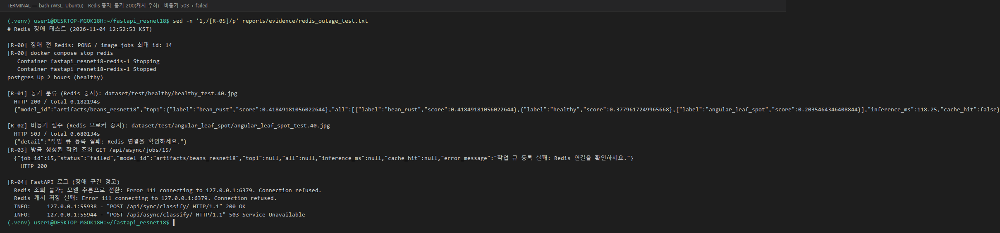 |
| Redis 복구 | 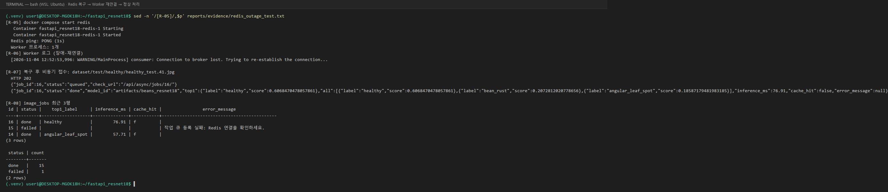 |
| DB failed 행 | 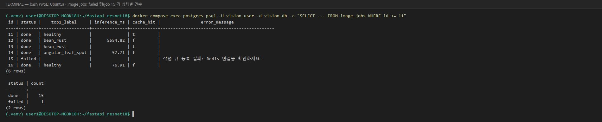 |
| 동기 분석 (정답 사례) | 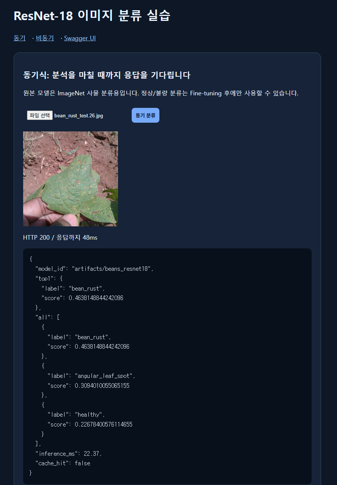 |
| 동기 분석 (오분류 사례) | 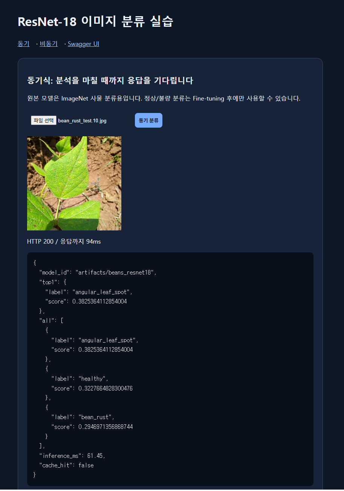 |
| 비동기 분석 | 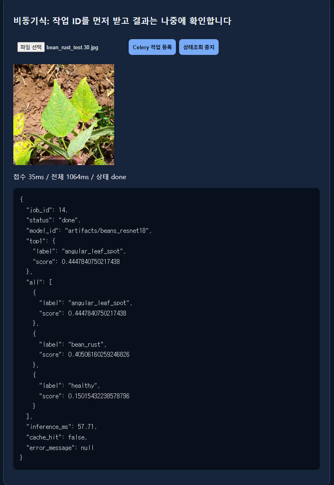 |
| 캐시 공유 | 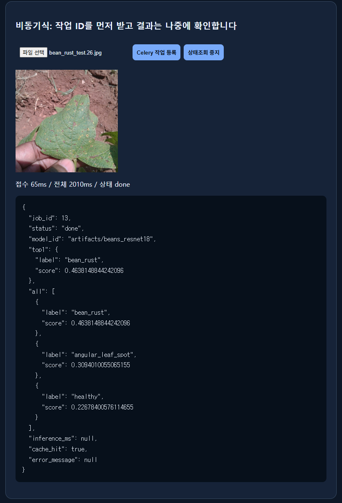 |
| Celery Worker 로그 | 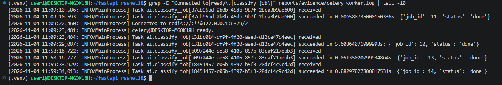 |
| Docker·Redis·PostgreSQL | 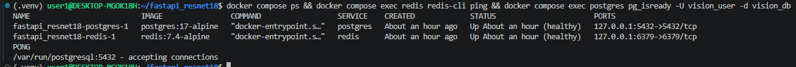 |
| DBeaver 작업 이력 | 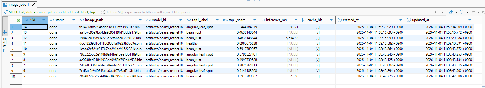 |
| 400 오류 | 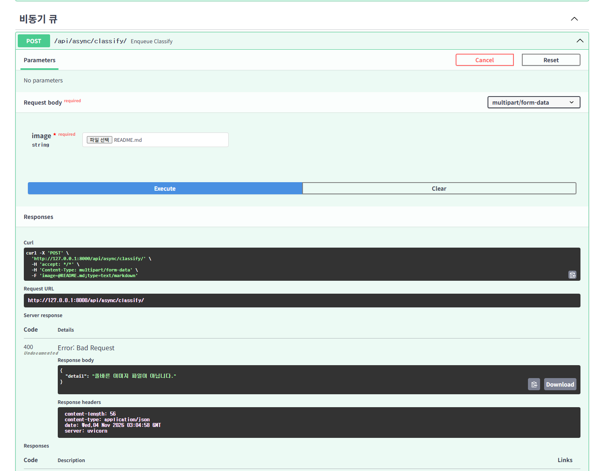 |
| 404 오류 | 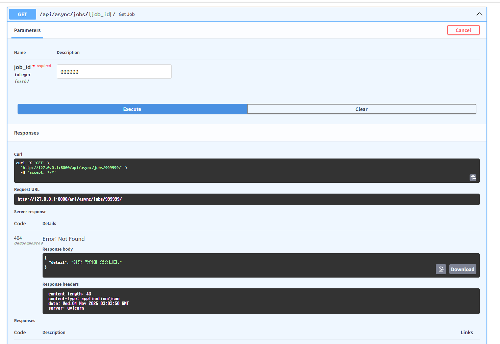 |
